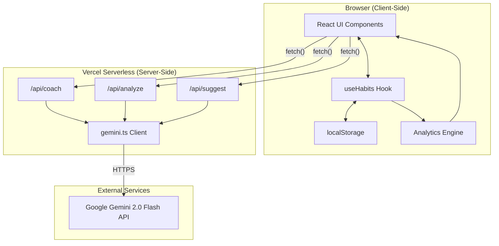
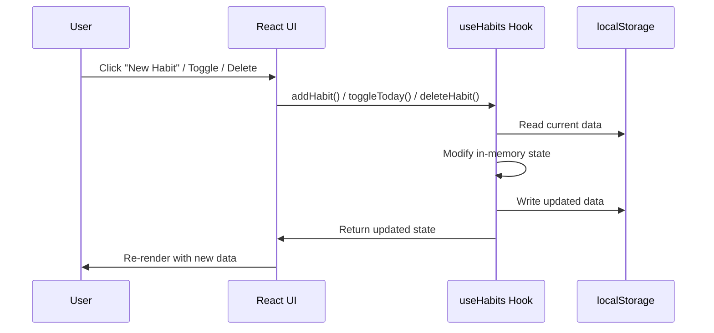
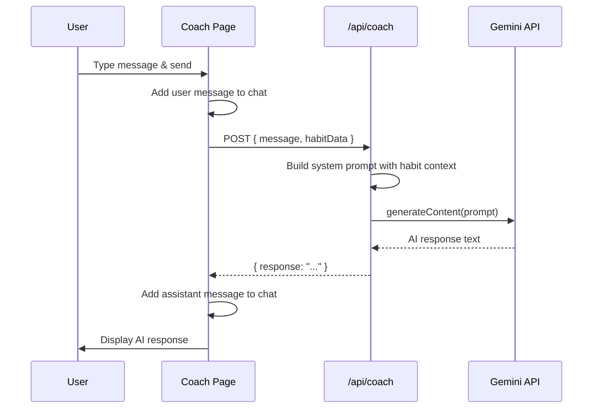
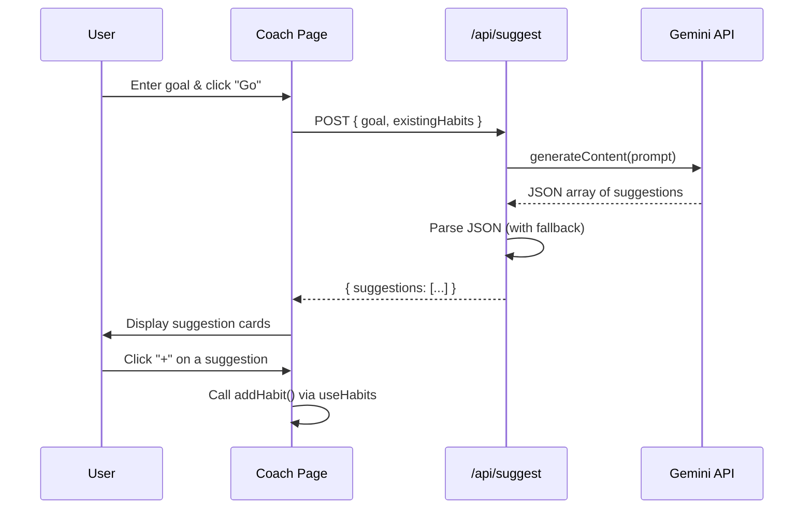
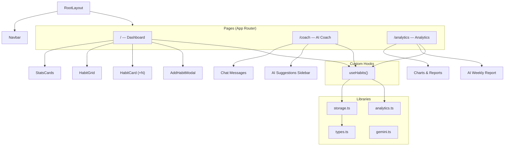
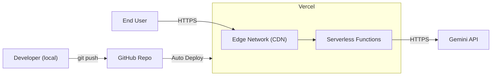

# HabitForge — System Architecture

**Version:** 1.0 | **Last Updated:** November 1, 2026

---

## 1. System Overview

HabitForge follows a **client-heavy architecture** where the frontend handles all data management (localStorage) and the backend (Next.js API routes) serves exclusively as a secure proxy to the Gemini AI API.



---

## 2. Tech Stack

| Layer | Technology | Version | Purpose |
|-------|-----------|---------|---------|
| **Framework** | Next.js (App Router) | 16.4.3 | Full-stack React framework |
| **Language** | TypeScript | 5.9.x | Type-safe development |
| **UI Library** | React | 19.3.0 | Component-based UI |
| **Styling** | Tailwind CSS | 4.3.x | Utility-first CSS (CSS-based config) |
| **Icons** | Lucide React | 1.66.x | Consistent icon set |
| **AI SDK** | @google/generative-ai | 0.24.x | Gemini API client |
| **Package Manager** | Bun | 1.4.2 | Fast JS package manager & runtime |
| **Hosting** | Vercel | — | Serverless deployment |
| **Data Storage** | localStorage | Browser API | Client-side persistence |

---

## 3. Directory Structure

```
habitforge/
├── docs/                          # 📄 Project documentation
│   ├── SRS.md                     #    Software Requirements Specification
│   ├── ARCHITECTURE.md            #    This file
│   ├── ENDPOINTS.md               #    API endpoint documentation
│   ├── IMPLEMENTATION_PLAN.md     #    Full implementation plan
│   └── CONTEXT.md                 #    Project improvement tracker
│
├── public/                        # 🌐 Static assets
│   └── favicon.ico
│
├── src/
│   ├── app/                       # 📱 Next.js App Router pages
│   │   ├── layout.tsx             #    Root layout (Navbar, fonts, meta)
│   │   ├── page.tsx               #    Dashboard (home page)
│   │   ├── globals.css            #    Global styles & Tailwind config
│   │   ├── coach/
│   │   │   └── page.tsx           #    AI Coach chat page
│   │   ├── analytics/
│   │   │   └── page.tsx           #    Analytics & reports page (TODO)
│   │   └── api/                   # 🔌 API Routes (server-side)
│   │       ├── coach/route.ts     #    AI coaching chat endpoint
│   │       ├── analyze/route.ts   #    Habit analysis endpoint
│   │       └── suggest/route.ts   #    Habit suggestion endpoint
│   │
│   ├── components/                # 🧩 Reusable UI components
│   │   ├── Navbar.tsx             #    Navigation bar + buildathon sticker
│   │   ├── HabitCard.tsx          #    Individual habit with toggle
│   │   ├── HabitGrid.tsx          #    GitHub-style activity grid
│   │   ├── StatsCards.tsx         #    Overview statistics cards
│   │   └── AddHabitModal.tsx      #    New habit creation modal
│   │
│   ├── hooks/                     # 🪝 Custom React hooks
│   │   └── useHabits.ts           #    Habit CRUD & state management
│   │
│   └── lib/                       # 📚 Utility libraries
│       ├── types.ts               #    TypeScript interfaces & constants
│       ├── storage.ts             #    localStorage CRUD operations
│       ├── analytics.ts           #    Streak & stats calculations
│       └── gemini.ts              #    Gemini API client wrapper
│
├── .env.local                     # 🔐 Environment variables (git-ignored)
├── next.config.js                 #    Next.js configuration
├── package.json                   #    Dependencies & scripts
├── bun.lock                       #    Bun lockfile
└── tsconfig.json                  #    TypeScript configuration
```

---

## 4. Data Flow Architecture

### 4.1 Habit CRUD Flow



### 4.2 AI Coach Flow



### 4.3 AI Suggestions Flow



---

## 5. Component Architecture



---

## 6. State Management

HabitForge uses a **hook-based state management** pattern — no external state library (Redux, Zustand, etc.) is needed.

| State | Location | Persistence |
|-------|----------|-------------|
| Habit definitions | `useHabits` hook → localStorage | Persistent (browser) |
| Habit completion logs | `useHabits` hook → localStorage | Persistent (browser) |
| Computed stats | Derived in `useHabits` from habits + logs | Computed on render |
| AI chat messages | `useState` in Coach page | Session only |
| AI suggestions | `useState` in Coach page | Session only |
| UI state (modals, menus) | `useState` in components | Session only |

---

## 7. Security Considerations

| Concern | Mitigation |
|---------|-----------|
| API key exposure | Gemini API key stored in `.env.local`, accessed only via server-side API routes; never sent to client |
| Input injection | AI prompts use template literals with user input; Gemini handles its own safety filters |
| Data privacy | All habit data stays in the user's browser (localStorage); only habit names/stats sent to Gemini for coaching |
| XSS | React's default JSX escaping; no `dangerouslySetInnerHTML` used |
| CORS | Next.js API routes are same-origin; no CORS configuration needed |

---

## 8. Deployment Architecture



| Environment | URL | Purpose |
|------------|-----|---------|
| Development | `http://localhost:3000` | Local development |
| Preview | `https://habitforge-*.vercel.app` | PR preview deployments |
| Production | `https://habitforge.vercel.app` | Live production app |

---

## 9. Performance Strategy

| Strategy | Implementation |
|----------|---------------|
| **Code Splitting** | Next.js App Router automatic route-based splitting |
| **Client Components** | Only pages and interactive components are `'use client'` |
| **Font Optimization** | `next/font/google` for Geist fonts (zero layout shift) |
| **Minimal Dependencies** | Only 3 runtime deps: `next`, `react`, `@google/generative-ai` + `lucide-react` |
| **No Database Overhead** | localStorage reads are synchronous and near-instant |
| **AI Caching** | API responses could be cached in future (not MVP) |

