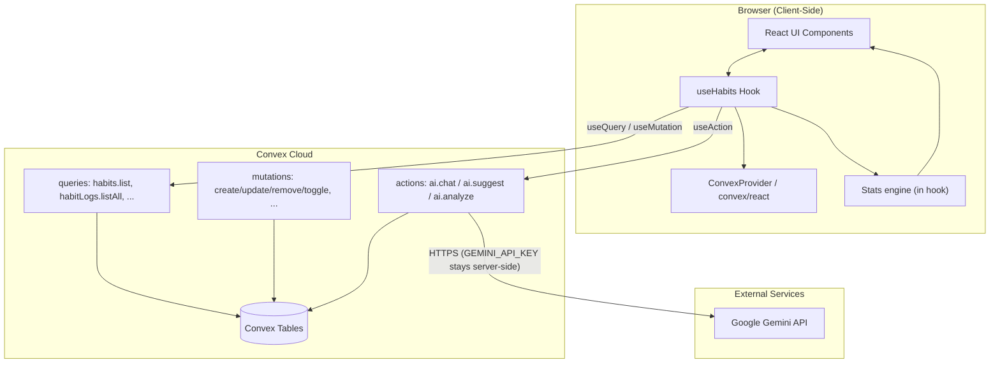
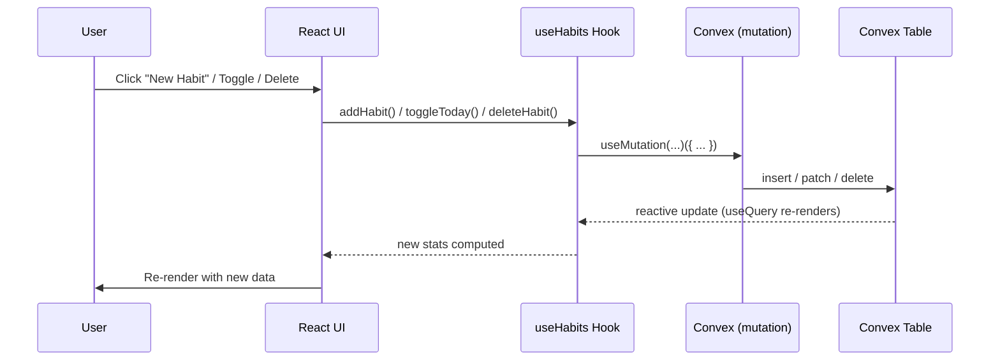
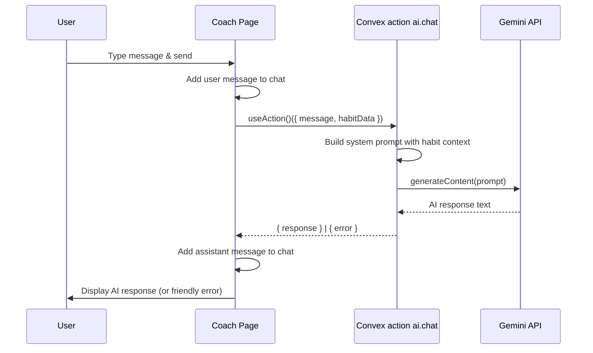
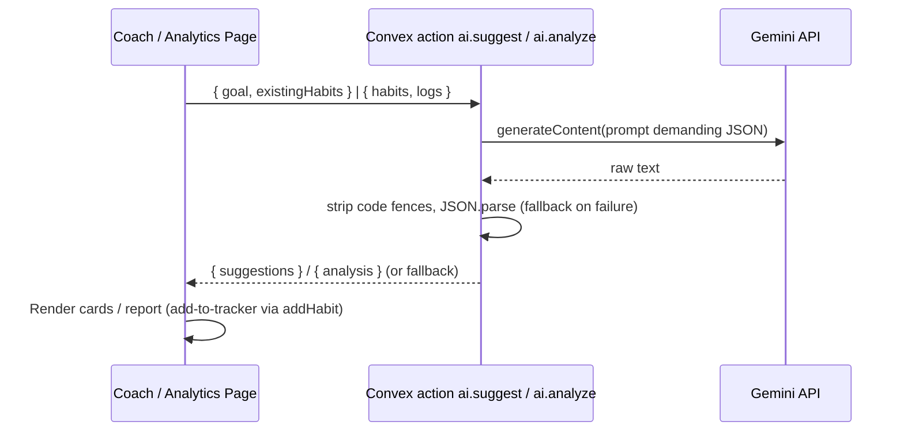
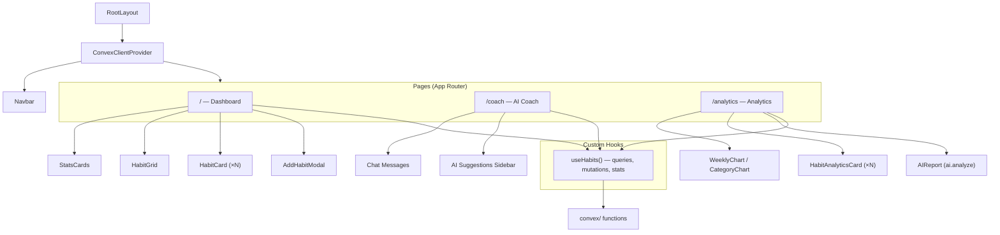
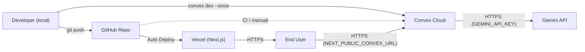

# HabitForge — System Architecture

**Version:** 2.0 | **Last Updated:** November 1, 2026

---

## 1. System Overview

HabitForge follows a **client-heavy architecture**: the React frontend holds all UI state, while
**Convex** provides persistence (tables), reactive sync (`useQuery`), and side-effect functions
(`actions`) that proxy the Google Gemini API. The Next.js server is only a static/SSR shell —
all data and AI traffic goes through Convex.



---

## 2. Tech Stack

| Layer | Technology | Version | Purpose |
|-------|-----------|---------|---------|
| **Framework** | Next.js (App Router) | 16.4.3 | Frontend shell, static prerender, fonts, metadata |
| **Language** | TypeScript | 5.9.x | Type-safe development |
| **UI Library** | React | 19.3.0 | Component-based UI |
| **Styling** | Tailwind CSS | 4.3.x | Utility-first CSS (CSS-based config) |
| **Icons** | Lucide React | 1.66.x | Consistent icon set |
| **Backend/DB** | Convex | 1.49.x | Tables, reactive queries, mutations, actions |
| **AI SDK** | @google/generative-ai | 0.24.x | Gemini client (runs inside Convex actions) |
| **Package Manager** | Bun | 1.4.2 | Fast JS package manager & runtime |
| **Hosting** | Vercel (frontend) + Convex (backend) | — | Serverless deployment |
| **AI model** | `gemini-3.8-flash` (override via `GEMINI_MODEL`) | — | Default chat/suggest/analyze model |

---

## 3. Directory Structure

```
habitforge/
├── docs/                          # 📄 Project documentation
│   ├── SRS.md                     #    Software Requirements Specification
│   ├── ARCHITECTURE.md            #    This file
│   ├── ENDPOINTS.md               #    Backend functions documentation
│   ├── IMPLEMENTATION_PLAN.md     #    Full implementation plan
│   └── CONTEXT.md                 #    Project improvement tracker
│
├── convex/                        # ☁️ Convex backend
│   ├── schema.ts                  #    Tables: habits, habitLogs (+ indexes)
│   ├── habits.ts                  #    Habit CRUD queries/mutations
│   ├── habitLogs.ts               #    Completion log queries/mutations
│   ├── ai.ts                      #    AI actions: chat, suggest, analyze (Gemini)
│   └── _generated/                #    Auto-generated API types (committed)
│
├── public/                        # 🌐 Static assets
│   └── favicon.ico
│
├── src/
│   ├── app/                       # 📱 Next.js App Router pages
│   │   ├── layout.tsx             #    Root layout (ConvexProvider, Navbar, fonts, meta)
│   │   ├── page.tsx               #    Dashboard (home page)
│   │   ├── globals.css            #    Global styles & Tailwind config
│   │   ├── coach/
│   │   │   └── page.tsx           #    AI Coach chat page
│   │   └── analytics/
│   │       └── page.tsx           #    Analytics & reports page (Phase 2)
│   │
│   ├── components/                # 🧩 Reusable UI components
│   │   ├── ConvexClientProvider.tsx #  ConvexReactClient + ConvexProvider
│   │   ├── Navbar.tsx             #    Navigation bar + buildathon sticker
│   │   ├── HabitCard.tsx          #    Individual habit with toggle
│   │   ├── HabitGrid.tsx          #    GitHub-style activity grid
│   │   ├── StatsCards.tsx         #    Overview statistics cards
│   │   └── AddHabitModal.tsx      #    New habit creation modal
│   │
│   ├── hooks/                     # 🪝 Custom React hooks
│   │   └── useHabits.ts           #    Convex state + streak/stats engine + actions
│   │
│   └── lib/                       # 📚 Shared types & constants
│       └── types.ts               #    HabitCategory, HabitLog, AIMessage, CATEGORY_CONFIG
│
├── .env.local                     # 🔐 CONVEX_DEPLOYMENT + NEXT_PUBLIC_CONVEX_URL (git-ignored)
├── package.json                   # Dependencies & scripts
├── bun.lock                       # Bun lockfile
└── tsconfig.json                  # TypeScript configuration
```

> **Removed in the Convex migration:** `src/app/api/*` (REST proxy routes),
> `src/lib/storage.ts` (localStorage), `src/lib/analytics.ts` (moved into the hook),
> `src/lib/gemini.ts` (moved into `convex/ai.ts`).

---

## 4. Data Flow Architecture

### 4.1 Habit CRUD Flow (reactive — no manual refresh)



### 4.2 AI Coach Flow



### 4.3 AI Suggestions & Weekly Report Flow



---

## 5. Component Architecture



---

## 6. State Management

Hook-based state via **Convex reactive queries** — no Redux/Zustand, no manual cache:

| State | Location | Persistence |
|-------|----------|-------------|
| Habit definitions | `useQuery(api.habits.list)` inside `useHabits` | Persistent (Convex) |
| Habit completion logs | `useQuery(api.habitLogs.listAll)` inside `useHabits` | Persistent (Convex) |
| Computed stats (streaks, rates, 7-day trend) | Derived in `useHabits` on every query update | Recomputed on render |
| AI chat messages | `useState` in Coach page | Session only |
| AI suggestions | `useState` in Coach page | Session only |
| UI state (modals, menus) | `useState` in components | Session only |

**Loading model:** Convex `useQuery` returns `undefined` until data arrives. `useHabits` exposes
`isLoaded`; before that it returns zeroed stats **without evaluating any date logic** (required
by Next.js 16 — `new Date()` must not run during static prerender).

---

## 7. Security Considerations

| Concern | Mitigation |
|---------|-----------|
| API key exposure | `GEMINI_API_KEY` lives in **Convex deployment env vars**, read only inside `convex/ai.ts` actions (`"use node"`); never bundled to the client |
| Input validation | Convex validators (`v.string()`, `v.id()`, unions) reject bad args before handlers run |
| Data privacy | Habit data stored in the user's Convex deployment; only habit names/stats are sent to Gemini in prompts |
| XSS | React's default JSX escaping; no `dangerouslySetInnerHTML` |
| Secrets in git | `.env*` is git-ignored; no secrets in source |

---

## 8. Deployment Architecture



| Environment | URL | Purpose |
|------------|-----|---------|
| Development | `http://localhost:3000` + Convex dev deployment | Local development |
| Preview | `https://habitforge-*.vercel.app` | PR preview deployments |
| Production | `https://habitforge.vercel.app` | Live production app |

**Vercel env vars needed:** `NEXT_PUBLIC_CONVEX_URL` (from `.env.local`).

---

## 9. Performance Strategy

| Strategy | Implementation |
|----------|---------------|
| **Code Splitting** | Next.js App Router automatic route-based splitting |
| **Client Components** | Only pages and interactive components are `'use client'` |
| **Font Optimization** | `next/font/google` for Geist fonts (zero layout shift) |
| **Indexed Reads** | Convex indexes on `habitId`, `date`, `habitId+date` — no full scans |
| **Minimal Dependencies** | Runtime deps: `next`, `react`, `convex`, `@google/generative-ai`, `lucide-react` |
| **Reactive Updates** | Only changed queries re-render — no refetch polling |
| **Static Prerender** | Dashboard/coach pages prerender as static shells; data streams in client-side |
