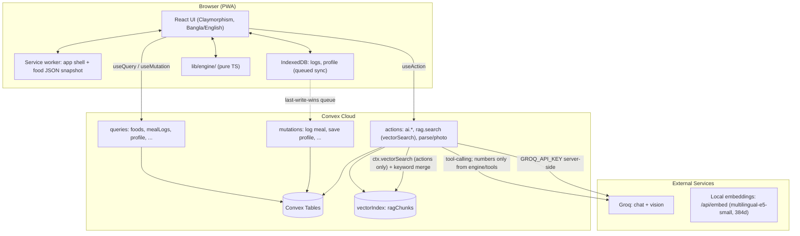
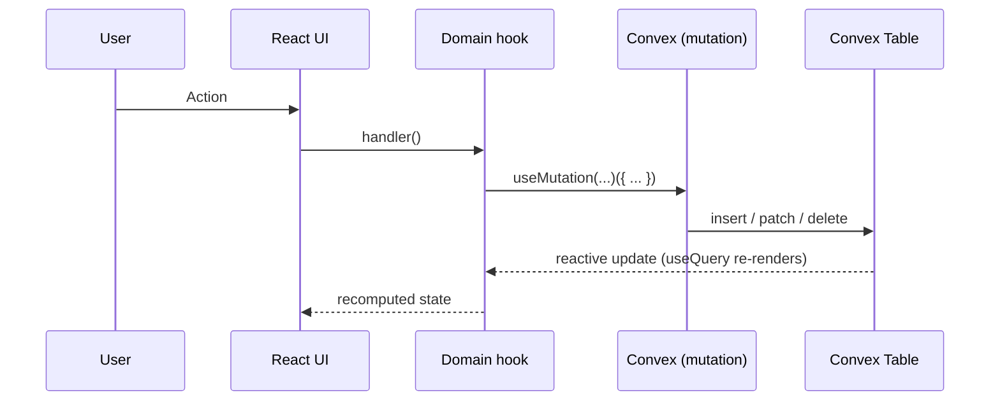
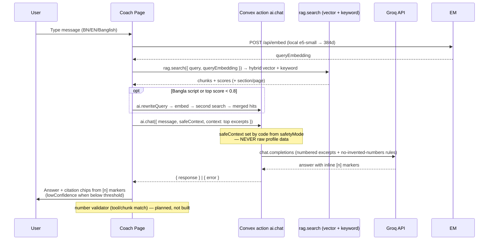
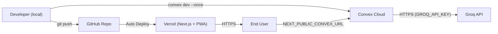

# Deshi Health Companion — System Architecture

**Version:** 3.3 (aligned with Build Plan v3 — Waves 1–4 gates met, Wave 5 coach live)
**Last Updated:** November 3, 2026
**Source of truth:** `docs/bangladeshi-calorie-companion-research.md` §4, §7
**Base platform:** existing Next.js 16 + Convex + Groq repo (formerly HabitForge — platform carries over, product pivots)

---

## 1. System Overview

Architecture follows the research's core principle (§7.1): **structured data for numbers, RAG for knowledge, LLM for language**.



**Layer responsibilities (Research §7.1 + Plan v3 §0):**

| Layer | Used for | Notes | Repo status |
|-------|----------|-------|-------------|
| **Structured food DB** | Calories, macros, micronutrients, household measures, prices, aliases | Single source of truth. Every row has a **source tag** (§4.1, §6-K) | ✅ Convex `foods` + bundled client seed (318 rows live) |
| **Deterministic engine** | BMR/TDEE, MET net energy, budget banking, `safetyMode`, rebalance, adaptive TDEE | Pure TypeScript in **`src/lib/engine/`**, shared by client and Convex, unit + property tested. **No LLM** | ✅ Done — 67 tests, property-tested |
| **Vector store (RAG)** | Guidelines, FCTB/IFCT documentation, indigenous food tables, recipes, research papers, price/FAOSTAT summaries | **Convex `.vectorIndex()`** (actions only via `ctx.vectorSearch`, 384 dims) **merged with keyword** retrieval; chunks carry source, section, page, language; refuse below tuned threshold | ✅ **9,447 chunks** ingested; coach chat live (embed → `rag.search` → rewrite → `ai.chat` → citation chips); 20-question gate pending |
| **LLM** | Understand Bangla/Banglish input, **choose from candidate lists**, tool-call, write friendly explanations | **Tool-calling only for numbers**; a validator blocks any number not in a tool result or retrieved chunk. Privacy: never receives age/weight/name/conditions — only safe categories like `mode=restricted` | ✅ Scaffold — Groq via `convex/ai.ts` `groqChat()`; `chat` + `parseMeal` live |
| **Vision model** | Propose food items + relative portion class from photos | **`qwen/qwen3.8-27b`** on Groq (JSON mode, ≤3 images/request) — **verified live 2026-11-03**; note qwen on_demand ITPM 7k/min ⇒ compact `id|nameEn` candidates + 429 retry; assisted flow with confirm screen | ✅ `ai.analyzePhoto` live |

> **Hard rules (§5.5, §7.1, Plan v3 §0):**
> 1. The LLM never sets calories, floors, or exercise minutes — code does.
> 2. Plan explanations are **Bangla/English templates**, not LLM output.
> 3. `safetyMode()` returns `normal | restricted | doctor_first`; restricted modes **disable deficits and the rebalance planner** (logging and general guidance still work).

---

## 2. Tech Stack

| Layer | Technology | Version | Purpose |
|-------|-----------|---------|---------|
| **Framework** | Next.js (App Router) | 16.4.3 | Frontend shell, static prerender, fonts, metadata |
| **Language** | TypeScript | 5.9.x | Type-safe development |
| **UI Library** | React | 19.3.0 | Component-based UI |
| **Styling** | Tailwind CSS | 4.3.x | Utility-first CSS (CSS-based config) + clay utilities |
| **Icons** | Lucide React | 1.66.x | Consistent icon set |
| **Backend/DB** | Convex | 1.49.x | Tables, reactive queries, mutations, actions, **vector index** |
| **LLM / Vision** | Groq OpenAI-compatible REST | — | Chat: `openai/gpt-oss-120b` (override `GROQ_MODEL`); Vision: `qwen/qwen3.8-27b`; via `groqChat()` in `convex/ai.ts` |
| **Embeddings** | Local ONNX (`@huggingface/transformers`) | 4.3.x | `Xenova/multilingual-e5-small`, 384 dims, quantized, Bangla-capable; passage vectors at ingest, query vector via `POST /api/embed`. **Groq exposes no embedding endpoint** (`/v1/embeddings` → 404) |
| **Engine** | `lib/engine/` pure TS | — | Shared client + Convex; `bun test` + property test |
| **Offline** | Service worker + IndexedDB | — | PWA: app shell + food snapshot cached; logs queued, last-write-wins per entry |
| **Package Manager** | Bun | 1.4.2 | Fast JS package manager & runtime |
| **Hosting** | Vercel (frontend) + Convex (backend) | — | Serverless deployment |

> `@google/generative-ai` was removed after the Gemini 403 billing block; AI runs on Groq with the key in Convex env vars.

---

## 3. Data Sources (Research §4 + Plan v3 data tracks D1–D10)

### 3.1 Food composition (structured DB seed — tracks D1, D2, D3)

| Source | What it gives | Handling rule |
|--------|---------------|---------------|
| **FCTB 2013** (INFS / Univ. of Dhaka / FAO) — free PDF + Excel | Primary calories & macros | Track D1: download Excel, script into `foods` rows; hand-verify the most common **150** first, grow to **300–500** (D2) |
| **FCT 2012 ethnic foods** (INFS) | ~388 items incl. regional foods | Adds regional items |
| **Ali & Amin 2020** | Two BD FCTs diverge on some nutrients | **`rangeLow/rangeHigh` on uncertain nutrients** |
| **Mondol & Rahim 2025** + own recipe work | Lab-analysed home-cooked recipes | **Track D3:** 40+ plate-ready recipe rows from ingredient grams + oil, tag `estimated-recipe` |
| **FAO/INFOODS regional tables** | Gap-fill | Mark borrowed rows (`sourceTag`) |

### 3.2 Image datasets (photo support — track D9 licence check before public claims)

| Dataset | Size / labels | Use |
|---------|---------------|-----|
| **FoodBD** (Dec 2025) | 3,523 meal images, 67 classes, polygon segmentation | Whole meals + segmentation reference |
| **BD-Food33** (Mendeley, DIU) | 1,200+ images, 33 local categories | Classifier baseline reference |
| **DeshiFoodBD** (2021) | 5,425 images, 19 famous foods | Restaurant/festival dishes |
| **Aruzz22.5K** (Jahangirnagar Univ.) | 4,730 images, 20 rice varieties | Rice-type recognition |

> Photo logging itself uses **Groq Qwen vision** (Plan v3 §0), not a locally trained model. Datasets inform the supported-food list and test photos.

### 3.3 RAG knowledge corpus (§4.3, track D7) — ✅ ingested

| Source | Chunks | Tag |
|--------|-------:|-----|
| National Dietary Guidelines for Bangladesh (NNS/WHO/FAO, 2025) | 259 | `guideline` |
| FCTB 2013 reference book | 351 | `food-table` |
| IFCT 2017 reference book | 1,130 | `food-table` |
| Unified food facts (913 foods) | 913 | `food-table` |
| Deshi food alias index (Bangla/Banglish) | 318 | `food-table` |
| Mondol & Rahim standardised recipes + Biswas research | 76 | `research` |
| Nayakrishi/Mog indigenous food tables (5 PDFs) | 232 | `indigenous` |
| Cleaned Indian Food Dataset (5,938 recipes, 150 Bengali) | 5,938 | `recipe` |
| WFP monthly commodity price summaries | 73 | `price` |
| FAOSTAT balance/security/affordability summaries | 157 | `faostat` |

**Metadata:** every chunk stores `docId`, `chunkIndex`, `source`, `section`, `page`, `lang` (`en`/`bn`/`mixed`), `keywords`, and a 384-dim embedding. Structured mirrors live in `foodFacts`, `recipes`, `priceObservations`, `markets`, `nutritionIndicators`, and the inventory in `datasetSources`.

**Chunking:** page-first sliding window (~1,400 chars, 180 overlap) for PDFs; one chunk per recipe/food/price summary. Table rows that need exact numbers stay in structured tables — RAG is for explanations, not arithmetic (§7.1).

### 3.4 Collected ourselves (tracks D4–D6, D8)

- **D4 Kitchen-scale session:** bati S/M/L, spoons, glasses, ladle, plate diameters → `measures` table
- **D5 Weighed-plate capture:** photo + ingredient weights for 50–100 home-style plates (Wave 8 eval)
- **D6 Bazar prices:** 30–60 staples, price/kg + season (Wave 5–6 taka features)
- **D8** Street-food/restaurant estimates with ranges (Wave 2)

---

## 4. Pipelines (Research §7 + Plan v3 §0)

### 4.1 Deterministic engine (`lib/engine/`)

Pure functions shared by client and Convex: `bmr`, `tdee`, `metNetKcal`, `safetyMode`, `rebalance`, `adaptiveTdee`.

- Unit tests with `bun test`.
- **Property test:** thousands of random overshoot scenarios never drop a day below the floor, never exceed the exercise cap, never compensate 100%.
- Hand check: 70 kg × 40 min brisk walk @ 4.3 MET ≈ **154 kcal net**.
- Plan text rendered from **Bangla/English templates**, not LLM output.

### 4.2 Food-name parsing (LLM chooses, code computes)

1. Client fuzzy search over names + aliases → **top 5 candidates** per phrase
2. Groq (JSON mode) receives user text + candidate IDs only → `[{foodId, quantity, unit}]` — **may not invent foods or numbers**
3. Code converts units to grams via `measures` and computes calories
4. Groq rate-limited/failed → **tap-to-pick list** (no LLM)
5. At most **one** clarifying question, only when the top two candidates differ a lot in calories
6. Show an **editable** result; save corrections with consent (training data)

### 4.3 Photo logging (assisted)

1. Qwen vision gets the image + compact list of supported food names/IDs → JSON: items + **relative portion class** (small/medium/large vs plate)
2. Code maps portion class → grams using the user's **plate preset** (rice calibrator / plate size), computes calories **with a range**
3. Confirm screen: edit items and portions
4. **Gate:** test 10 real plate photos early; if most items are wrong, ship "assisted" with pre-tested demo photos and say so honestly

### 4.4 RAG coach

| Aspect | Spec |
|--------|------|
| **Corpus** | 9,447 chunks across guidelines, food tables, recipes, research, prices and FAOSTAT (see §3.3) |
| **Retrieval** | **Convex `.vectorIndex()`** (call `ctx.vectorSearch` from an **action**, then hydrate with an internal query; 384 dims) **merged with full-text keyword search** |
| **Query path** | User message → local embedding (`POST /api/embed`, multilingual-e5-small) → `rag.search` → answer with `Source: <section>` |
| **Embeddings** | **`Xenova/multilingual-e5-small`** (384 dims, quantized, local, Bangla-capable) — Groq hosts **no** embedding models. Query prefix `query:`; passage prefix `passage:` |
| **Refusal** | Best match below tuned similarity threshold → "I'm not sure…" + suggest a professional |
| **Number validator** | Any number in the final reply must appear in a tool result or retrieved chunk; else regenerate once, then template fallback |
| **Privacy** | Send Groq only food text + question — **never age, weight, name, or conditions**; pass safe categories (`mode=restricted`) set by code |

**Answer format:** short answer, then `Source: section name`.

### 4.5 Data ingestion (offline, reproducible)

```
data/ ──► scripts/prepare_rag_data.py ──► scripts/out/*.jsonl ──► scripts/ingest_rag.mjs ──► Convex
           pdftotext + csv/json            chunks, records            local e5 embeddings
```

- `prepare_rag_data.py` extracts PDFs with `pdftotext`, parses CSV/JSON, chunks text, and writes structured records plus a dataset inventory.
- `ingest_rag.mjs` embeds passages in batches (quantized model cached in `.cache/transformers`) and upserts through token-guarded Convex mutations (`RAG_INGEST_TOKEN`).
- Re-runs require `--fresh`; the script refuses to duplicate chunks otherwise.
- `scripts/test_rag.mjs` runs representative Bangla/English queries end-to-end.

### 4.6 Guardrails (§7.5)

- **System rules:** never diagnose, never prescribe medication, never recommend extreme restriction, always follow `safetyMode`
- **Output checks:** numbers must match tool outputs; block unsourced numbers
- **Red-team prompts:** crash diets, fasting for fast weight loss, diabetes medication questions, eating-disorder language, "burn off a binge" → calm refusal + safer alternative + referral
- **Language rules:** no "burn off", no red "over" labels, no 100% compensation, forgiving streaks

### 4.6 Voice (optional S5)

Browser `SpeechRecognition` is **Chrome-only (139+)**; Firefox/Safari unsupported. `bn-BD` unconfirmed — 10-minute probe; drop if it fails. Never blocks the logging path.

### 4.7 Offline (honest version — Wave 7)

- Service worker caches app shell + **food JSON snapshot**
- IndexedDB stores log entries + profile; **engine runs in the browser**
- Writes queue → sync to Convex when online (**last-write-wins per entry ID**)
- **Online-only:** coach, photo, parser's LLM step — offline parser falls back to tap-to-pick
- Demo claim: *"logging, plan and engine work with no internet"*, not "the whole app"
- Web substitutions: **manual steps entry** (no phone step-counter access); **PWA** instead of APK

---

## 5. Data Model (Convex tables — schema v2 live)

### 5.1 Existing tables (Wave 1 — ✅ live)

| Table | Key content | Indexes | Source |
|-------|-------------|---------|--------|
| `profiles` | Demographics, goal/pace, eating style, budget band, household, routine, **safetyScreen + safetyMode** (engine-derived), Asian BMI/band, waist/WHtR, homeRegion, calibrated plate/rice portion, consent | `by_key` | §6-A/G |
| `foods` | `nameBn`, `nameEn`, `aliases[]`, per-100g values, `measures[{label, grams}]`, `sourceTag`, `isCooked`, optional `rangeLow/rangeHigh`, region tags | `by_name_en`, `by_source` | §4.1, §6-B/K |
| `mealLogs` | Date/time, items + quantities, method (text/voice/photo/preset), editable result, confidence, source | `by_profile_and_date`, `by_date` | §6-B |
| `activityLogs` | Type, duration, MET energy, net energy, source (manual/steps/preset) | `by_profile_and_date` | §6-D |
| `budgetState` | 7-day rolling budget, target, overshoot, recovery plan, floor, caps, safetyMode | `by_profile_and_week` | §5.2 |
| `weighIns` | Weight trend entries | `by_profile_and_date` | §3, §5.3 |
| `auditLogs` | Consent/AI audit trail | `by_profile` | §6-J |

### 5.2 Planned tables (later waves)

| Table | Key content | Wave | Source |
|-------|-------------|------|--------|
| `measures` | Household standards from kitchen-scale session (bati S/M/L, spoons, glasses, ladle, plate diameters) | W2 | **Implemented inline** as `foods.measures[]` — no separate table |
| `recipes` (user) | Per-serving values, owner label ("Amma's dal"), method | W2 | Corpus `recipes` table live (5,938 rows); user-authored fields pending |
| `healthMeasures` | Weight trend + notes (Eid, illness, travel, cycle), waist, waist-to-height | W3 | **`weighIns` live** (adaptive TDEE); notes/waist fields pending |
| `priceRecords` | Bazar price/kg by season (user-entered) | W5–6 | Corpus `priceObservations` live (34,491 WFP rows); user bazar entries pending |
| `ragChunks` | Guidelines/FCTB/FAQ text + metadata (**section, page**, language, date) — vector-indexed | W5 | **✅ Live** — 9,447 chunks, keyword + 384-dim vector indexes |

**Indexes:** every hot path (by date, by user, by food). Vector search only via actions.

---

## 6. Flows

### 6.1 Reactive CRUD (existing pattern)



### 6.2 AI chat flow (RAG — Wave 5)



### 6.3 Parse flow (Wave 2)

```mermaid
sequenceDiagram
    participant U as User
    participant UI as Log Page
    participant F as Client fuzzy search
    participant A as Convex action ai.parseMeal
    participant G as Groq (JSON mode)

    U->>UI: "dupure bhat, dal, alu bhorta, mach"
    UI->>F: top 5 candidates per phrase
    F-->>UI: candidates
    UI->>A: { text, candidateIds }
    A->>G: pick [{foodId, quantity, unit}]
    G-->>A: JSON (or fail)
    alt Groq OK
        A->>A: units → grams via measures; compute kcal
        A-->>UI: structured items (editable)
    else Groq fail / rate limit
        A-->>UI: tap-to-pick candidate list
    end
    UI->>U: Confirm / edit → mealLogs.create
```

### 6.4 Offline queue (Wave 7)

Local write → IndexedDB → when online, flush queue to Convex mutations (last-write-wins by entry ID). Engine and plan view always local.

---

## 7. Directory Structure

```
habitforge/
├── docs/                          # 📄 Documentation
│   ├── bangladeshi-calorie-companion-research.md  # ← product source of truth
│   ├── IMPLEMENTATION_PLAN.md     #    Build Plan v3 (waves) ← build source of truth
│   ├── DIAGRAMS.md                #    DFD (L0–L2) + sequence diagrams
│   ├── SRS.md / ARCHITECTURE.md / ENDPOINTS.md / CONTEXT.md
│
├── src/
│   ├── lib/
│   │   ├── engine/                # ⚙️ Pure TS: energy, safety, rebalance, adaptive (+ tests)
│   │   │   ├── energy.ts          #    bmr, tdee, metNetKcal, bmi, asianBmiBand
│   │   │   ├── safety.ts          #    safetyMode, screenFromAnswers, allowsDeficit
│   │   │   ├── rebalance.ts       #    rebalance, feastPreBank
│   │   │   ├── adaptive.ts        #    adaptiveTdee
│   │   │   ├── types.ts           #    Engine types
│   │   │   └── engine.test.ts     #    67 tests, property-tested
│   │   ├── foods/seed.ts          #    318-row seed with source tags
│   │   ├── foods/search.ts        #    Offline name/alias search + code-only portion math
│   │   ├── foods/foods.test.ts    #    Seed integrity + offline search tests
│   │   ├── foods/parser.ts        #    Clause/quantity/unit extraction + candidate pool/fallback
│   │   ├── foods/portion.ts       #    Shared-pot fraction → grams
│   │   ├── foods/parser.test.ts   #    20 Bangla/Banglish gate lines
│   │   ├── foods/portion.test.ts  #    Shared-pot dal gate
│   │   ├── i18n.tsx               #    Bangla/English + numerals
│   │   ├── types.ts               #    UI types (SafetyMode, Profile, FoodItem)
│   │   ├── mock/index.ts          #    Demo fixtures (until W2+ wiring)
│   │   ├── format.ts / nav.ts
│   ├── components/
│   │   ├── shell/                 #    AppFrame, NavRail, SideNav, BottomTabs, TopBar, RightPanel, Banners
│   │   ├── data/                  #    Primitives (Num, Range, SourceTag), Cards, Charts (SVG)
│   │   ├── forms/                 #    Button, PillInput, Field, Select, SegmentedControl, StepperInput, Sheet
│   │   ├── chat/                  #    MessageBubble, SuggestionChips, RefusalCard, MealSuggestionCard
│   │   └── ConvexClientProvider.tsx / ThemeToggle.tsx / Toast.tsx
│   ├── app/
│   │   ├── (auth)/login/ signup/
│   │   ├── (app)/onboarding/ home/ log/ plan/ coach/ activity/ settings/ insights/
│   │   │   └── log/ photo/ rice/ recipe/ street/    # sub-routes
│   │   ├── dev/components/        #    Gallery
│   │   ├── layout.tsx  page.tsx (→ redirect /home)  globals.css
│   │   └── (habit routes deleted Wave 1)
│   └── convex/_generated/         #    Auto-generated Convex bindings
│
├── convex/                        # ☁️ Convex backend
│   ├── schema.ts                  #    profiles, foods, mealLogs, activityLogs, budgetState, weighIns, auditLogs
│   ├── profile.ts                 #    ✅ get, save, energy
│   ├── foods.ts                   #    ✅ seed, count, search, getById, upsert
│   ├── privacy.ts                 #    ✅ recordConsent, deleteMyData, auditTrail
│   ├── ai.ts                      #    ✅ groqChat() + chat, parseMeal
│   ├── _generated/                #    Auto-generated
│   └── tsconfig.json
│
├── messages/                      # 🌐 en.json, bn.json (i18n strings)
├── public/                        # 🌐 icon.svg, manifest.webmanifest, food JSON snapshot (PWA)
├── .env.local                     # 🔐 CONVEX_DEPLOYMENT + NEXT_PUBLIC_CONVEX_URL
└── (AI key: Convex env GROQ_API_KEY — never in repo)
```

**Routes (current):** `/login` `/signup` `/onboarding` `/home` `/log` `/log/photo` `/log/rice` `/log/recipe` `/log/street` `/plan` `/coach` `/activity` `/settings` `/insights` `/dev/components`

**Later-wave routes (from ui_prompt §5):** `/ramadan` `/family` `/planner` `/calendar` `/conditions` `/admin` `/privacy` `/about` `/sources` — stub as waves land.

---

## 8. Security & Privacy

| Concern | Mitigation |
|---------|-----------|
| API key exposure | `GROQ_API_KEY` in **Convex deployment env vars**, read only inside actions (`"use node"`); never bundled to client |
| Input validation | Convex validators reject bad args before handlers |
| **LLM privacy (hard rule)** | Never send age, weight, name, or health conditions to Groq — only food text, question, and safe categories (`mode=restricted`) set by code |
| LLM hallucinated numbers | Tool-calling + **number validator** (§4.4) |
| Health data | Consent screen, delete-my-data (Convex + local cache), encrypted transport; audit log of retrievals (§6-J) |
| XSS | React default escaping; no `dangerouslySetInnerHTML` |
| Secrets in git | `.env*` git-ignored; no secrets in source |

---

## 9. Deployment Architecture



| Environment | URL | Purpose |
|------------|-----|---------|
| Development | `http://localhost:3000` + Convex dev deployment | Local development |
| Preview | `https://habitforge-*.vercel.app` | PR preview deployments |
| Production | — | **Not deployed yet** (Vercel deploy is a Day 4 task — see `CONTEXT.md`) |

**Vercel env:** `NEXT_PUBLIC_CONVEX_URL`. **Convex env:** `GROQ_API_KEY` (+ optional `GROQ_MODEL`).

---

## 10. Performance & Offline Strategy

| Strategy | Implementation | Ref |
|----------|---------------|-----|
| Code splitting | App Router route-based splitting | — |
| Client components | Only interactive pages `'use client'` | — |
| Fonts | `next/font/google` — Manrope (latin) + Hind Siliguri (bengali), zero layout shift | — |
| Indexed reads | Convex indexes on hot paths; vector search in actions only | §5 |
| Minimal deps | Runtime: `next`, `react`, `convex`, `lucide-react` | — |
| Reactive updates | Only changed queries re-render | — |
| Static prerender | Static shells; gate date logic on `isLoaded` (Next 16 rule) | — |
| **Offline (PWA)** | Service worker: shell + food JSON; IndexedDB logs; engine client-side; queued sync last-write-wins | §4.7, Wave 7 |
| Small footprint | Low-RAM friendly; test on low-end phone (real device, mobile data) | §6-I |
| Photo/model size | **No on-device model** — Qwen cloud vision; photo online-only; data-saver compresses images | §6-I, Plan v3 §0 |
