# Deshi Health Companion — Data Flow Diagrams & Sequence Diagrams

**Version:** 1.0
**Date:** November 2, 2026 (flows updated Nov 3 for live `budget.get` / client-side RAG coach)
**Source of truth:** `docs/bangladeshi-calorie-companion-research.md` §5, §7; `docs/ARCHITECTURE.md`

---

## 1. DFD — Level 0 (Context Diagram)

The system boundary. External entities interact with the single process **"Deshi Health Companion"**.

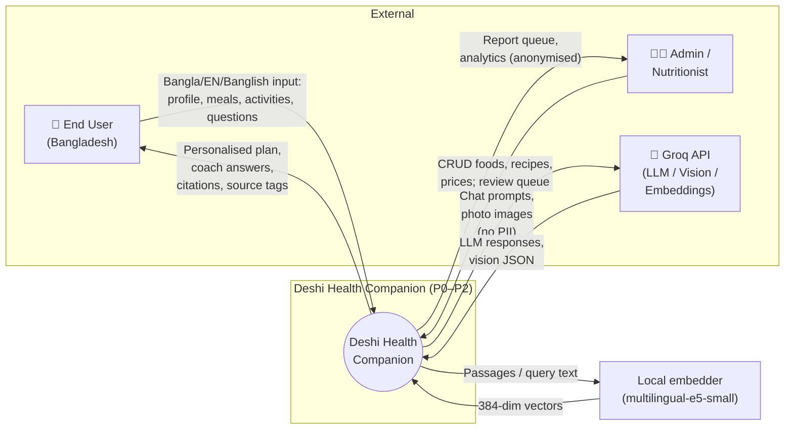

**Data stores at Level 0:**
- Convex Tables (profiles, foods, mealLogs, activityLogs, budgetState, weighIns, auditLogs)
- IndexedDB (offline queue, food JSON snapshot)

---

## 2. DFD — Level 1 (Major Processes)

Decomposes the system into **7 primary processes**, each with inputs, outputs, and data stores.

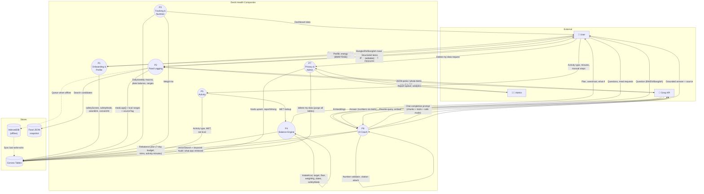

### Level 1 — Process summaries

| Process | Name | Key inputs | Key outputs | Stores |
|---------|------|-----------|-------------|--------|
| **P1** | Onboarding & Profile | Demographics, screening answers, consent | `safetyMode`, Asian BMI, energy (BMR/TDEE) | `profiles`, `auditLogs` |
| **P2** | Food Logging | Meal text, photos, household measures | `mealLogs[]` with kcal ranges + source tags | `mealLogs`, `foods` |
| **P3** | Tracking & Nutrition | Logs, weigh-ins | Daily/weekly macros, plate balance, ranges | `mealLogs`, `weighIns`, `foods` |
| **P4** | Balance Engine | Intake, target, floor, weight, dates, safetyMode | 7-day budget, rebalance plan | `budgetState` |
| **P5** | Activity | Activity type, minutes, MET | Net kcal (engine-computed) | `activityLogs` |
| **P6** | AI Coach | User question, safe categories | Grounded answer + citations | `ragChunks` (vector), `auditLogs` |
| **P7** | Privacy & Admin | Admin CRUD, delete-my-data | Purged data, report queue | All tables |

---

## 3. DFD — Level 2 (Sub-processes)

### 3.1 P2 — Food Logging (Level 2)

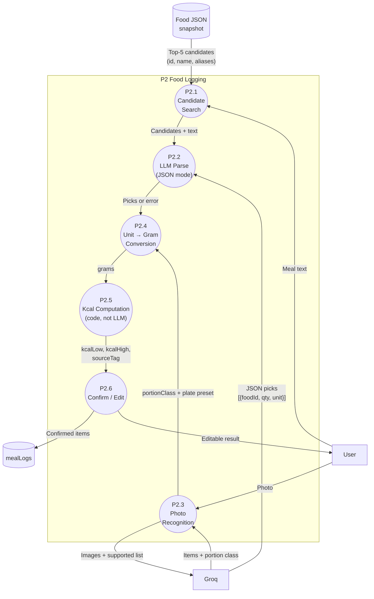

| Sub-process | Input | Output | Notes |
|-------------|-------|--------|-------|
| P2.1 | User text, food JSON | Top-5 candidates per phrase | Client-side fuzzy search |
| P2.2 | Text + candidate IDs | `[{foodId, qty, unit}]` | LLM picks from list only; may not invent foods |
| P2.3 | Photo images | Items + portion class (S/M/L) | Qwen vision, ≤3 images, JSON mode |
| P2.4 | quantity + unit + measures | grams | Code converts via `measures[]` |
| P2.5 | grams + food row | kcal range + sourceTag | **Code computes, never LLM** |
| P2.6 | Structured items | Confirmed `mealLogs` | Always editable; save corrections with consent |

### 3.2 P4 — Balance Engine (Level 2)

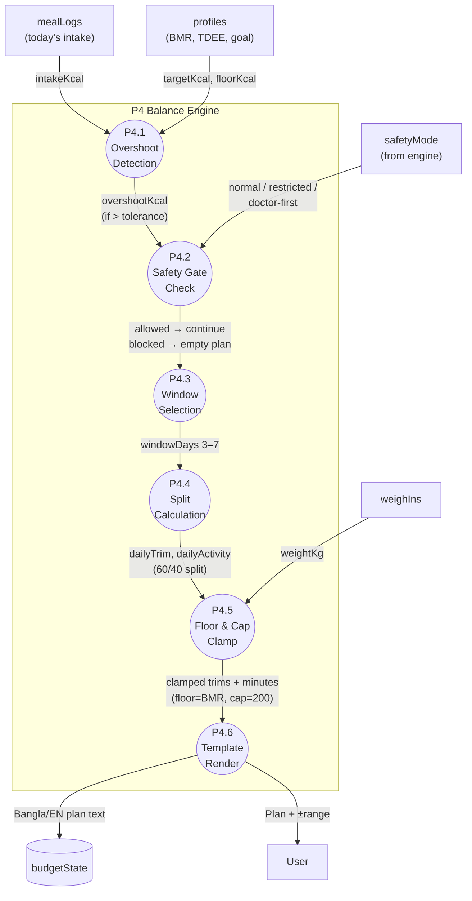

| Sub-process | Input | Output | Rules |
|-------------|-------|--------|-------|
| P4.1 | intakeKcal, targetKcal | overshootKcal (or 0) | Only when `intake − target > 100` |
| P4.2 | safetyMode | allowed / blocked | restricted + doctor-first → blocked |
| P4.3 | overshoot size | windowDays | 3–7 (default 4) |
| P4.4 | coveredKcal, intakeShare | dailyTrim, dailyActivity | 60/40 split; never 100% cover |
| P4.5 | trim, activity, floor, cap | Clamped values | Floor = BMR; cap = 200 net kcal/day |
| P4.6 | Numeric plan | Bangla/EN text | **Templates only, not LLM** |

### 3.3 P6 — AI Coach RAG (Level 2)

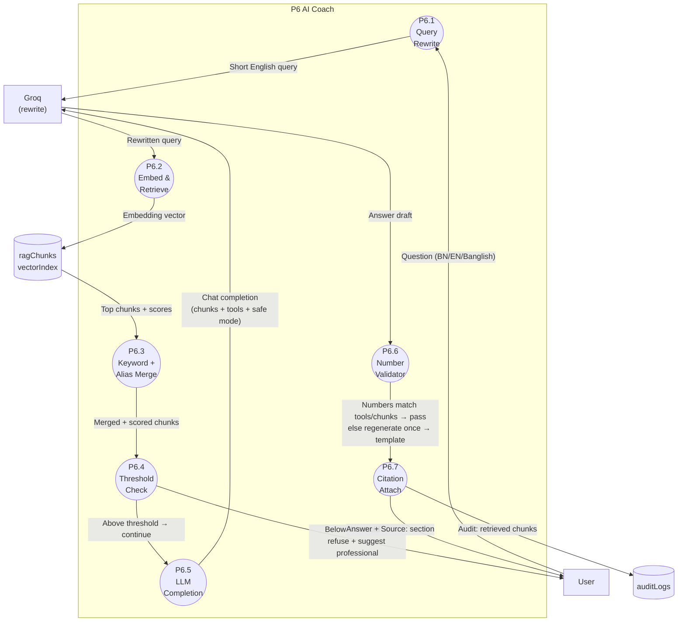

| Sub-process | Input | Output | Notes |
|-------------|-------|--------|-------|
| P6.1 | User question | Short English query | LLM rewrites; extracts food names |
| P6.2 | Query text | Embedding + top chunks | Local `multilingual-e5-small` via `POST /api/embed`; `ctx.vectorSearch` |
| P6.3 | Vector results | Merged + keyword/alias match | Hybrid retrieval |
| P6.4 | Best score | Pass / refuse | Below threshold → refuse |
| P6.5 | Chunks + safe mode | Answer draft | Numbers only via tools |
| P6.6 | Draft answer | Validated answer | Every number must appear in tool result or chunk |
| P6.7 | Validated answer | Answer + citations | `Source: <section name>` |

### 3.4 P1 — Onboarding & Safety (Level 2)

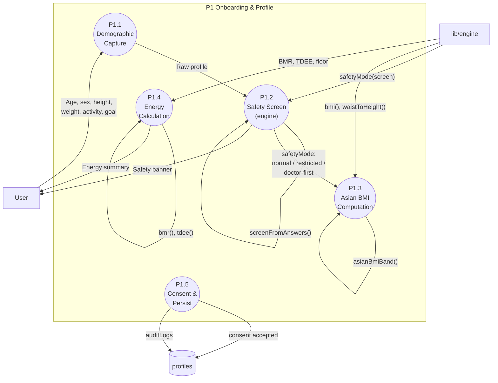

| Sub-process | Input | Output | Engine function |
|-------------|-------|--------|-----------------|
| P1.1 | Form data | Raw profile object | — |
| P1.2 | Demographics + screening answers | `safetyMode` | `screenFromAnswers()`, `safetyMode()` |
| P1.3 | weightKg, heightCm, waistCm | `asianBmiBand`, WHtR | `bmi()`, `asianBmiBand()`, `waistToHeight()` |
| P1.4 | Profile | BMR, TDEE, floor | `bmr()`, `tdee()` |
| P1.5 | Consent + all derived fields | Persisted `profiles` row | — |

---

## 4. Sequence Diagrams

### 4.1 Onboarding → Safety Mode → Persist

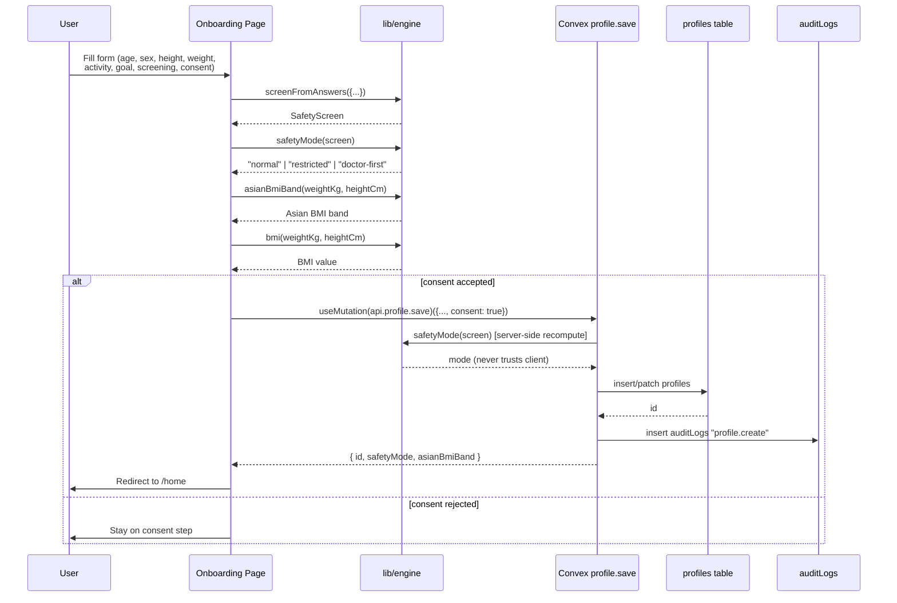

### 4.2 Meal Logging (Text → Parse → Confirm)

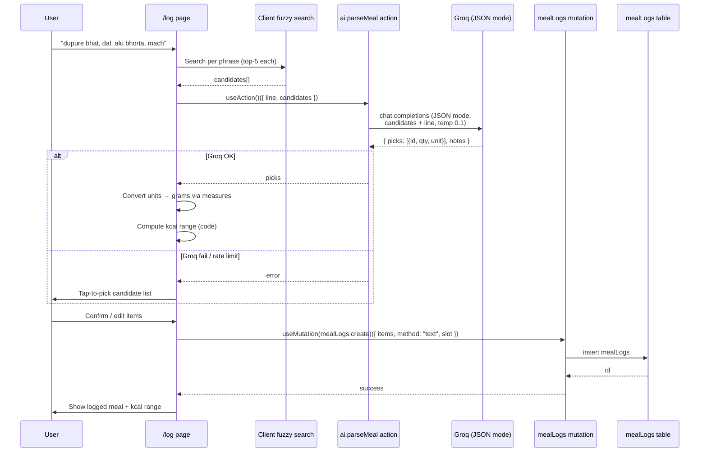

### 4.3 Photo Logging (Assisted)

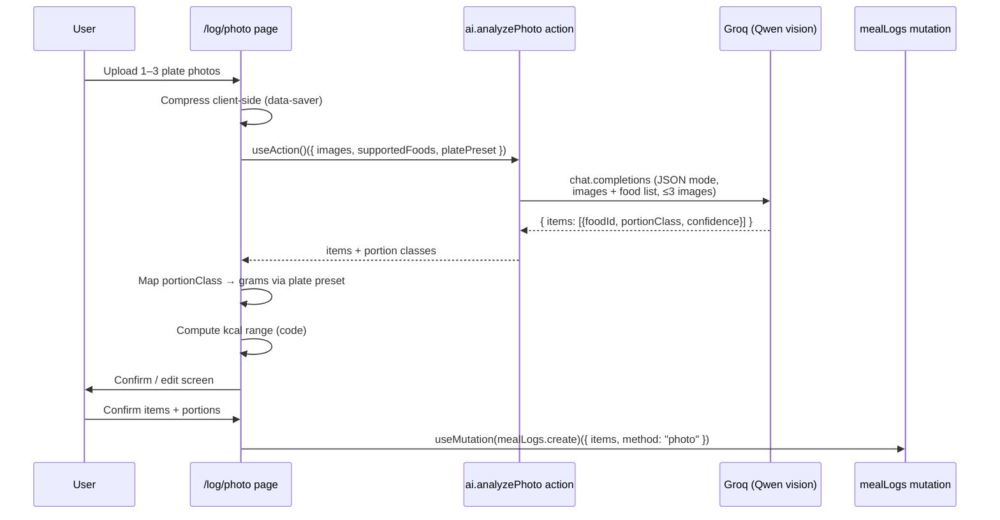

### 4.4 Balance Engine (Overshoot → Rebalance Plan)

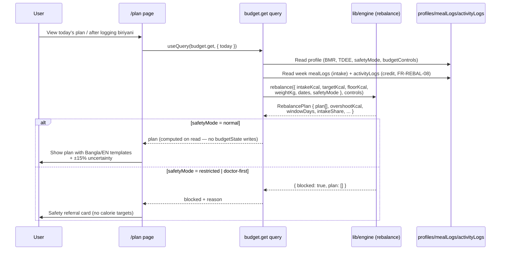

### 4.5 AI Coach RAG Chat

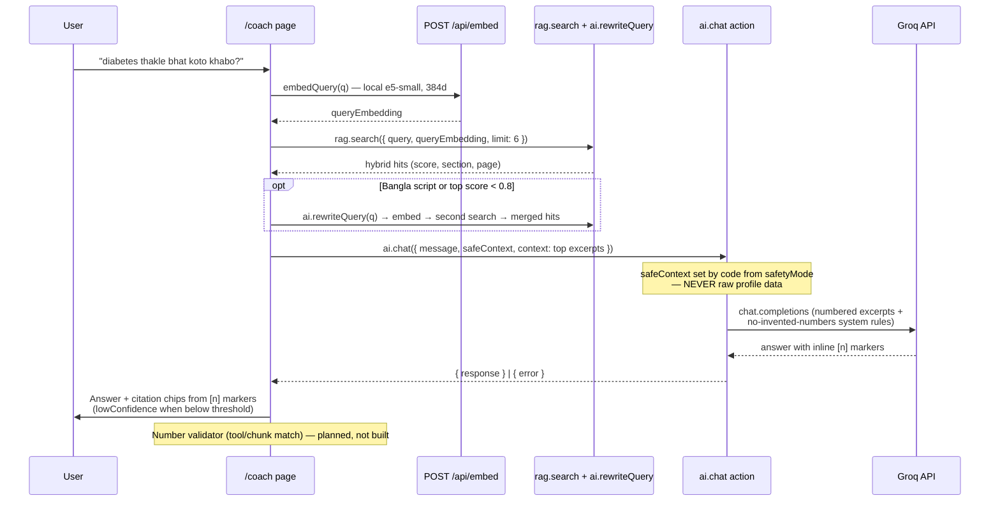

### 4.6 Privacy — Delete My Data

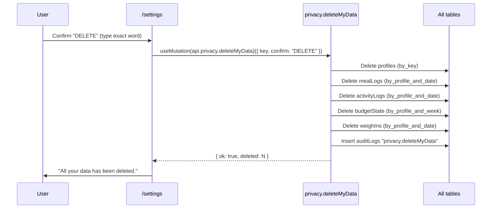

### 4.7 Offline Queue (Wave 7)

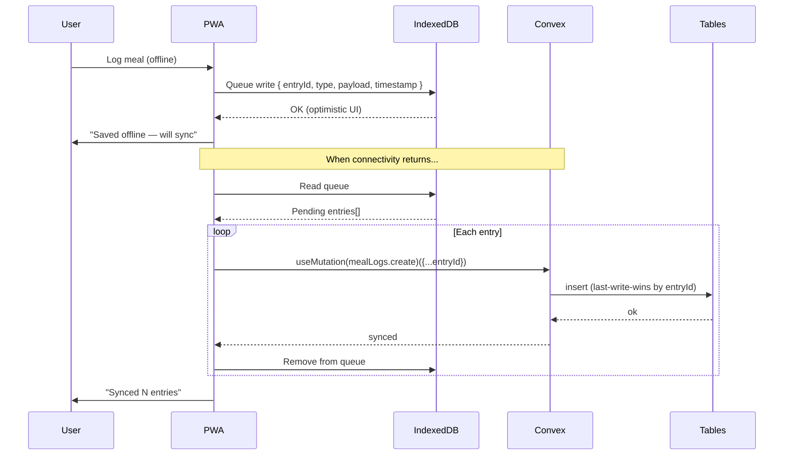

### 4.8 Activity Logging (MET)

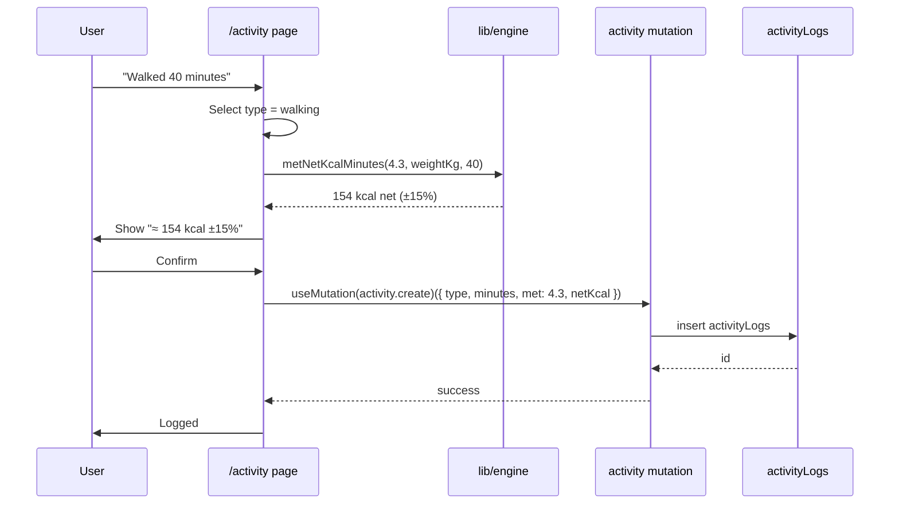

---

## 5. Data Flow Summary Table

| DFD Level | Process | Data In | Data Out | Store | Engine / LLM |
|-----------|---------|---------|----------|-------|--------------|
| **L1** | P1 Onboarding | Demographics, screening | safetyMode, BMI, energy | profiles | Engine |
| **L1** | P2 Logging | Meal text, photos | mealLogs | mealLogs | LLM (parse) + Code (kcal) |
| **L1** | P3 Tracking | Logs, weigh-ins | Macros, ranges | mealLogs, weighIns | Engine |
| **L1** | P4 Balance | Intake, target, floor | Rebalance plan | budgetState | Engine |
| **L1** | P5 Activity | Type, minutes, MET | Net kcal | activityLogs | Engine |
| **L1** | P6 Coach | Question, safe mode | Answer + citations | ragChunks, auditLogs | LLM + RAG |
| **L1** | P7 Privacy | Delete request, admin CRUD | Purged data | All tables | — |
| **L2** | P2.1 Search | User text | Top-5 candidates | Food JSON | Client |
| **L2** | P2.2 Parse | Text + candidates | Picks | — | LLM (JSON mode) |
| **L2** | P2.3 Photo | Images | Items + portions | — | LLM (vision) |
| **L2** | P2.4 Convert | qty + unit | grams | — | Code |
| **L2** | P2.5 Compute | grams + food row | kcal range | — | Code |
| **L2** | P4.1 Overshoot | intake, target | overshootKcal | — | Code |
| **L2** | P4.2 Safety | safetyMode | allowed/blocked | — | Engine |
| **L2** | P4.3 Window | overshoot | windowDays | — | Code |
| **L2** | P4.4 Split | coveredKcal | trim + activity | — | Code |
| **L2** | P4.5 Clamp | trim, activity | clamped values | — | Engine |
| **L2** | P4.6 Render | Numeric plan | Bangla/EN text | — | Templates |
| **L2** | P6.1 Rewrite | Question | English query | — | LLM |
| **L2** | P6.2 Retrieve | Query | Chunks + scores | ragChunks | Embeddings |
| **L2** | P6.4 Threshold | Best score | Pass/refuse | — | Code |
| **L2** | P6.5 Complete | Chunks + tools | Answer draft | — | LLM |
| **L2** | P6.6 Validate | Draft | Validated answer | — | Code |
| **L2** | P6.7 Cite | Answer | Answer + sources | auditLogs | Code |
