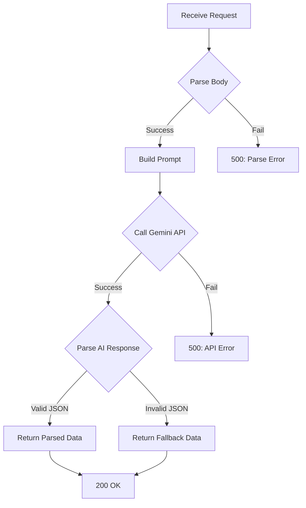

# HabitForge — API Endpoints Documentation

**Version:** 1.0 | **Last Updated:** November 1, 2026
**Base URL:** `https://habitforge.vercel.app` (production) | `http://localhost:3000` (development)

---

## Overview

All API routes are implemented as Next.js App Router Route Handlers under `src/app/api/`. They run server-side as Vercel serverless functions and serve as a secure proxy to the Google Gemini API.

| Endpoint | Method | Purpose | Auth |
|----------|--------|---------|------|
| `/api/coach` | POST | AI coaching chat | None (API key server-side) |
| `/api/analyze` | POST | Habit data analysis & weekly report | None (API key server-side) |
| `/api/suggest` | POST | AI-powered habit suggestions | None (API key server-side) |

> [!NOTE]
> All endpoints use the Gemini 2.0 Flash model via the `@google/generative-ai` SDK. The API key is stored in the `GEMINI_API_KEY` environment variable and is never exposed to the client.

---

## 1. `POST /api/coach`

### Description
Send a message to the AI habit coach and receive a personalized response. The coach has access to the user's habit data for contextual advice.

### Request

```http
POST /api/coach
Content-Type: application/json
```

**Body:**

```json
{
  "message": "How can I stay consistent with my morning routine?",
  "habitData": {
    "habits": [
      {
        "name": "Morning meditation",
        "category": "mindfulness",
        "currentStreak": 5,
        "completionRate": 72,
        "todayCompleted": true
      }
    ],
    "totalHabits": 3,
    "completedToday": 2
  }
}
```

| Field | Type | Required | Description |
|-------|------|----------|-------------|
| `message` | `string` | ✅ | User's message to the AI coach |
| `habitData` | `object \| null` | ❌ | User's current habit summary for context |
| `habitData.habits` | `array` | ❌ | Array of habit summaries |
| `habitData.habits[].name` | `string` | ❌ | Habit name |
| `habitData.habits[].category` | `string` | ❌ | Habit category |
| `habitData.habits[].currentStreak` | `number` | ❌ | Current consecutive days |
| `habitData.habits[].completionRate` | `number` | ❌ | Completion percentage (0–100) |
| `habitData.habits[].todayCompleted` | `boolean` | ❌ | Whether completed today |
| `habitData.totalHabits` | `number` | ❌ | Total active habits |
| `habitData.completedToday` | `number` | ❌ | Habits completed today |

### Response

**Success (200):**

```json
{
  "response": "Great question! 🌅 Based on your data, you're already doing well with morning meditation (5-day streak!). Here's what I'd suggest to stay consistent:\n\n1. **Stack your habits** — pair your meditation with something you already do, like right after brushing your teeth.\n2. **Start smaller on tough days** — even 2 minutes counts and keeps the streak alive.\n\nYou've completed 2 out of 3 habits today — keep that momentum going! 💪"
}
```

| Field | Type | Description |
|-------|------|-------------|
| `response` | `string` | AI coach's text response |

**Error (500):**

```json
{
  "error": "Failed to get AI response. Please check your API key."
}
```

### AI Behavior
- Personality: Warm, encouraging, honest, solutions-focused
- Uses emojis sparingly
- Keeps responses to 2–4 paragraphs
- References user's actual habit data when available
- Gives specific, actionable advice

---

## 2. `POST /api/analyze`

### Description
Analyze the user's habit tracking data and generate a structured weekly report with scores, strengths, areas for improvement, and motivational tips.

### Request

```http
POST /api/analyze
Content-Type: application/json
```

**Body:**

```json
{
  "habits": [
    {
      "id": "m3x7k2a",
      "name": "Drink water",
      "category": "health",
      "currentStreak": 7,
      "completionRate": 85,
      "totalCompletions": 12
    }
  ],
  "logs": [
    {
      "habitId": "m3x7k2a",
      "date": "2026-11-01",
      "completed": true
    }
  ]
}
```

| Field | Type | Required | Description |
|-------|------|----------|-------------|
| `habits` | `HabitWithStats[]` | ✅ | Array of habits with computed statistics |
| `logs` | `HabitLog[]` | ✅ | Array of all completion logs |

### Response

**Success (200):**

```json
{
  "analysis": {
    "overallScore": 78,
    "summary": "You've had a strong week with 78% overall completion. Your health habits are leading the way, while productivity habits need more attention.",
    "strengths": [
      "Excellent consistency with health habits (7-day streak!)",
      "High completion rate shows strong commitment"
    ],
    "improvements": [
      "Productivity habits were completed only 40% of the time",
      "Consider setting specific times for each habit"
    ],
    "tip": "Try the 2-minute rule: if a habit takes less than 2 minutes, do it right now instead of postponing.",
    "motivation": "You're building something amazing, one day at a time! 🔥"
  }
}
```

| Field | Type | Description |
|-------|------|-------------|
| `analysis.overallScore` | `number` | 0–100 score for the week |
| `analysis.summary` | `string` | 2–3 sentence overview |
| `analysis.strengths` | `string[]` | Things the user is doing well |
| `analysis.improvements` | `string[]` | Areas to focus on |
| `analysis.tip` | `string` | One actionable tip for next week |
| `analysis.motivation` | `string` | Short motivational message |

**Fallback Response (200):** If AI response cannot be parsed as JSON, a default structure is returned with the raw AI text as the `summary`.

**Error (500):**

```json
{
  "error": "Failed to analyze habits."
}
```

---

## 3. `POST /api/suggest`

### Description
Generate AI-powered habit suggestions based on a user's stated goal. Returns specific, actionable habits with categories.

### Request

```http
POST /api/suggest
Content-Type: application/json
```

**Body:**

```json
{
  "goal": "Be more productive as a student",
  "existingHabits": [
    { "name": "Morning meditation" },
    { "name": "Read for 30 minutes" }
  ]
}
```

| Field | Type | Required | Description |
|-------|------|----------|-------------|
| `goal` | `string` | ✅ | User's goal or aspiration |
| `existingHabits` | `{ name: string }[]` | ❌ | User's current habits (to avoid duplicates) |

### Response

**Success (200):**

```json
{
  "suggestions": [
    {
      "name": "Plan tomorrow's top 3 tasks before bed",
      "description": "Writing down priorities reduces morning decision fatigue and keeps you focused on what matters most.",
      "category": "productivity"
    },
    {
      "name": "Take a 5-minute walk between study sessions",
      "description": "Short movement breaks improve concentration and prevent mental fatigue during long study periods.",
      "category": "fitness"
    },
    {
      "name": "Review and organize notes within 24 hours",
      "description": "Spaced review dramatically improves retention and makes exam prep much easier.",
      "category": "learning"
    }
  ]
}
```

| Field | Type | Description |
|-------|------|-------------|
| `suggestions` | `array` | 3–5 habit suggestions |
| `suggestions[].name` | `string` | Specific, actionable habit name |
| `suggestions[].description` | `string` | Why this habit helps achieve the goal |
| `suggestions[].category` | `HabitCategory` | One of: health, fitness, mindfulness, productivity, learning, social, creativity, other |

**Fallback Response (200):** If AI response cannot be parsed, returns 3 generic default suggestions.

**Error (500):**

```json
{
  "error": "Failed to generate suggestions."
}
```

---

## Error Handling Strategy

All endpoints follow a consistent error handling pattern:



| Error Type | HTTP Status | Behavior |
|-----------|-------------|----------|
| Request parsing failure | 500 | Returns error message |
| Gemini API failure | 500 | Returns user-friendly error |
| AI response not valid JSON | 200 | Returns fallback/default data |
| Missing API key | 500 | Returns "check your API key" message |

---

## Rate Limiting & Quotas

| Constraint | Limit | Notes |
|-----------|-------|-------|
| Gemini API free tier | 15 RPM / 1M TPM | Sufficient for single-user demo |
| Vercel serverless | 100 GB-hours/month (free) | More than enough for buildathon |
| Request payload size | ~100KB max | Habit data is small |

---

## Environment Variables

| Variable | Required | Description |
|----------|----------|-------------|
| `GEMINI_API_KEY` | ✅ | Google Gemini API key from [AI Studio](https://aistudio.google.com/) |

### Setup

```bash
# Create .env.local in project root
echo "GEMINI_API_KEY=your_api_key_here" > .env.local
```

> [!CAUTION]
> Never commit `.env.local` to version control. It is already included in `.gitignore` by default.

