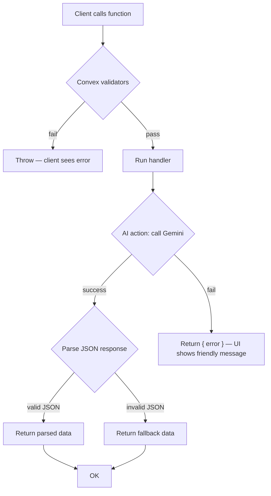

# HabitForge — Backend Functions Documentation

**Version:** 2.0 | **Last Updated:** November 1, 2026
**Backend:** Convex | **Deployment:** `dev:disciplined-zebra-716` (project `habitforge`)
**URL:** `https://disciplined-zebra-716.ap-southeast-2.convex.cloud`

---

## Overview

HabitForge's backend lives in the `convex/` directory and runs on [Convex](https://convex.dev).
It provides **queries** (reactive reads), **mutations** (writes), and **actions** (side effects —
here, calls to the Google Gemini API). The Next.js frontend consumes them via `convex/react`
hooks — there are no REST API routes in this app anymore.

| Module | Functions | Purpose |
|--------|-----------|---------|
| `convex/habits.ts` | `list`, `listAll`, `get`, `create`, `update`, `remove`, `archive` | Habit CRUD |
| `convex/habitLogs.ts` | `listAll`, `listByHabit`, `listByDate`, `getByHabitAndDate`, `toggle`, `addNote` | Completion logs |
| `convex/ai.ts` | `chat`, `suggest`, `analyze` (actions) | Gemini AI: coach chat, habit suggestions, weekly report |

> [!NOTE]
> All AI functions run **inside Convex actions** (`"use node"`), where `GEMINI_API_KEY` is read
> from Convex deployment environment variables — never exposed to the browser.

---

## Environment Variables

| Variable | Where set | Required | Description |
|----------|-----------|----------|-------------|
| `NEXT_PUBLIC_CONVEX_URL` | `.env.local` (git-ignored) | ✅ | Convex deployment URL for the client |
| `CONVEX_DEPLOYMENT` | `.env.local` (auto-written by `convex dev`) | ✅ | Active deployment selector |
| `GEMINI_API_KEY` | **Convex env** (`bunx convex env set GEMINI_API_KEY=...`) | ✅ for AI | Google Gemini API key |
| `GEMINI_MODEL` | Convex env (optional) | ❌ | Overrides model (default `gemini-3.8-flash`) |

### Setup

```bash
# One-time (writes .env.local, generates convex/_generated/, pushes schema)
bunx convex login
bunx convex dev --once

# Gemini key lives on the Convex deployment, not in .env.local
bunx convex env set GEMINI_API_KEY=your_api_key_here
```

> [!CAUTION]
> Never commit `.env.local` or put `GEMINI_API_KEY` in client-side code. Both files are covered
> by `.gitignore`.

---

## 1. `habits` module (`convex/habits.ts`)

### Queries

| Function | Args | Returns | Notes |
|----------|------|---------|-------|
| `habits.list` | — | `Habit[]` | Non-archived habits (what the UI uses) |
| `habits.listAll` | — | `Habit[]` | Includes archived |
| `habits.get` | `id: Id<"habits">` | `Habit \| null` | Single habit |

### Mutations

| Function | Args | Notes |
|----------|------|-------|
| `habits.create` | `name`, `description`, `category`, `color`, `frequency`, `customDays?` | Inserts with `archived: false`; returns new `Id` |
| `habits.update` | `id`, plus any of the create fields, `archived?` | Partial patch |
| `habits.remove` | `id` | Deletes habit **and all its logs** |
| `habits.archive` | `id` | Soft-hide (`archived: true`) |

**Categories:** `health` | `fitness` | `mindfulness` | `productivity` | `learning` | `social` | `creativity` | `other`
**Frequencies:** `daily` | `weekdays` | `weekends` | `custom` (with `customDays: number[]`, 0=Sunday)

---

## 2. `habitLogs` module (`convex/habitLogs.ts`)

A log exists only on days the habit was **completed** (toggling off deletes the log) — so a log
row *is* the completion event.

### Queries

| Function | Args | Returns |
|----------|------|---------|
| `habitLogs.listAll` | — | all logs (used by `useHabits` for stats) |
| `habitLogs.listByHabit` | `habitId` | logs for one habit |
| `habitLogs.listByDate` | `date` (`YYYY-MM-DD`) | logs for one day |
| `habitLogs.getByHabitAndDate` | `habitId`, `date` | single log or `null` |

### Mutations

| Function | Args | Notes |
|----------|------|-------|
| `habitLogs.toggle` | `habitId`, `date` | Creates log if missing, deletes if present; returns new state |
| `habitLogs.addNote` | `habitId`, `date`, `note` | Attaches a note to an existing completion |

**Indexes:** `by_habit`, `by_date`, `by_habit_date` — all hot paths are indexed.

---

## 3. AI actions (`convex/ai.ts`)

All three are **actions** (call them with `useAction(api.ai.*)` in React or
`bunx convex run ai:<fn>` in the CLI). They take `habitData` as plain JSON — no Convex
queries inside — so the client sends the stats it already has.

### 3.1 `ai.chat` — Coaching conversation

```ts
await chatAction({
  message: "How can I stay consistent?",
  habitData: {          // optional, but recommended
    habits: [{ name, category, currentStreak, completionRate, todayCompleted }],
    totalHabits: 3,
    completedToday: 2,
  },
});
// → { response: string } | { error: string }
```

**Behavior:** warm, encouraging coach; references the user's actual habit data; 2–4 paragraphs;
actionable advice. On failure returns `{ error }` — the UI shows a friendly message and the app
keeps working (tracking never depends on AI).

### 3.2 `ai.suggest` — Goal → habit suggestions

```ts
await suggestAction({
  goal: "Be more productive as a student",
  existingHabits: [{ name: "Morning meditation" }],   // optional, avoids duplicates
});
// → { suggestions: [{ name, description, category }] } | { error: string }
```

Returns 3–5 suggestions in one of the 8 categories. If the model's JSON can't be parsed, a set
of **safe fallback suggestions** is returned instead (always 200).

### 3.3 `ai.analyze` — Weekly report

```ts
await analyzeAction({
  habits: [...],   // habit list with computed stats
  logs: [...],     // completion logs
});
// → { analysis: {
//       overallScore: number,      // 0–100
//       summary: string,
//       strengths: string[],
//       improvements: string[],
//       tip: string,
//       motivation: string,
//     } } | { error: string }
```

On unparseable model output, returns a **fallback analysis** (score 50, raw text as summary).

---

## Error Handling Strategy



| Failure | Behavior |
|---------|----------|
| Bad arguments | Convex validators reject before handler runs |
| Gemini API error (403/404/quota) | `{ error }` returned; UI renders fallback/error state |
| Model returns non-JSON | Fallback suggestions / fallback analysis returned (still success) |
| No `GEMINI_API_KEY` | `{ error: "Failed to get AI response..." }` |

**Habit tracking always works — even when AI is down (NFR-REL-01).**

---

## Rate Limiting & Quotas

| Constraint | Limit | Notes |
|-----------|-------|-------|
| Gemini API | per Google project | Free tier currently **403 for this project** — see CONTEXT.md |
| Convex free tier | generous for single-user demo | Queries/mutations are cheap |
| Payload size | habit data is tiny (< a few KB) | `habitData` sent per chat message |

---

## Local Development

```bash
bun run dev              # Next.js on :3000
bunx convex dev          # separate terminal — watches convex/ and redeploys

# Test functions directly:
bunx convex run habits:list
bunx convex run ai:suggest '{"goal":"sleep better"}'
```
