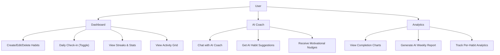

# HabitForge — Software Requirements Specification (SRS)

**Version:** 1.0
**Date:** November 1, 2026
**Project:** HabitForge — AI Habit Tracker & Accountability Coach
**Buildathon:** Ostad Presents YUNet AIgnite Buildathon 2026
**Author:** Solo Participant

---

## 1. Introduction

### 1.1 Purpose
This document specifies the software requirements for HabitForge, an AI-powered habit tracking and coaching web application. It serves as the authoritative reference for design, development, testing, and evaluation throughout the buildathon (November 1–5, 2026).

### 1.2 Scope
HabitForge is a B2C web application that enables users to create, track, and maintain daily habits with the assistance of an AI-powered coaching system. The application targets students and young professionals who want to build consistent routines but struggle with accountability and motivation.

### 1.3 Definitions & Acronyms

| Term | Definition |
|------|-----------|
| **Habit** | A recurring action the user wants to perform on a regular schedule |
| **Streak** | Consecutive days a habit has been completed without missing |
| **Log** | A single completion record for a habit on a specific date |
| **AI Coach** | The Gemini-powered conversational assistant that provides habit advice |
| **Completion Rate** | Percentage of days a habit was completed since creation |
| **HabitGrid** | GitHub-style contribution graph showing habit activity over time |

### 1.4 References
- YUNet AIgnite Buildathon 2026 Rules & Guidelines
- Google Gemini API Documentation
- Next.js 16 App Router Documentation

---

## 2. Overall Description

### 2.1 Product Perspective
HabitForge is a standalone web application. It stores all data in **Convex** (cloud tables with reactive sync) and communicates with the Google Gemini API through Convex actions, which run server-side. The Next.js app is a static/SSR frontend shell. No user authentication is required for the MVP; data lives in the team's Convex deployment.

### 2.2 Product Functions (High-Level)



### 2.3 User Classes & Characteristics

| User Class | Description | Technical Level |
|-----------|-------------|-----------------|
| **Primary: Students (16–25)** | High school and university students in Bangladesh looking to build study habits, fitness routines, and productivity systems | Low–Medium |
| **Secondary: Young Professionals** | Early-career individuals wanting to establish professional habits | Medium |

### 2.4 Operating Environment
- **Client:** Modern web browser (Chrome 90+, Firefox 88+, Safari 14+, Edge 90+)
- **Server:** Vercel serverless functions (Node.js 20+)
- **External API:** Google Gemini 2.0 Flash
- **Min Screen:** 320px width (mobile-first responsive design)

### 2.5 Design Constraints
- **No Authentication:** MVP has no accounts or login; data is stored in a single shared Convex deployment
- **Cloud Database (Convex):** Habits and logs persist in Convex tables with realtime sync across devices
- **API Key Server-Side:** `GEMINI_API_KEY` stored in Convex deployment env vars, accessed only inside `convex/ai.ts` actions; never sent to the client
- **Buildathon Sticker:** Must be visibly displayed in the navbar per buildathon rules

### 2.6 Assumptions & Dependencies
- User has a modern web browser with JavaScript enabled
- User has a stable internet connection (required — data lives in Convex, AI features need Gemini)
- Google Gemini API is available and the API key's project can call the model (currently 403 — see CONTEXT.md)
- Convex free tier and Vercel free tier provide adequate hosting

---

## 3. Functional Requirements

### 3.1 Habit Management (FR-HAB)

| ID | Requirement | Priority |
|----|------------|----------|
| FR-HAB-01 | User SHALL be able to create a new habit with name, description, category, and frequency | **Must** |
| FR-HAB-02 | User SHALL be able to delete an existing habit and all its associated logs | **Must** |
| FR-HAB-03 | User SHALL be able to toggle a habit as complete/incomplete for today | **Must** |
| FR-HAB-04 | System SHALL persist all habit data in Convex | **Must** |
| FR-HAB-05 | System SHALL assign habits to one of 8 categories: health, fitness, mindfulness, productivity, learning, social, creativity, other | **Must** |
| FR-HAB-06 | User SHALL be able to set frequency: daily, weekdays, weekends, or custom | **Should** |
| FR-HAB-07 | User SHALL be able to edit an existing habit's name, description, and category | **Should** |
| FR-HAB-08 | User SHALL be able to archive a habit (hide without deleting) | **Could** |

### 3.2 Streak & Statistics Tracking (FR-STAT)

| ID | Requirement | Priority |
|----|------------|----------|
| FR-STAT-01 | System SHALL calculate current streak (consecutive days completed up to today) | **Must** |
| FR-STAT-02 | System SHALL calculate longest streak for each habit | **Must** |
| FR-STAT-03 | System SHALL calculate completion rate (% of days completed since creation) | **Must** |
| FR-STAT-04 | System SHALL display total check-ins across all habits | **Must** |
| FR-STAT-05 | System SHALL display today's progress (completed/total habits) | **Must** |
| FR-STAT-06 | System SHALL display a GitHub-style activity grid for the last 12 weeks | **Must** |
| FR-STAT-07 | System SHALL display last 7 days completion rate trend | **Should** |

### 3.3 AI Coach (FR-AI)

| ID | Requirement | Priority |
|----|------------|----------|
| FR-AI-01 | User SHALL be able to chat with the AI Coach in natural language | **Must** |
| FR-AI-02 | AI Coach SHALL have access to the user's current habit data for context | **Must** |
| FR-AI-03 | AI Coach SHALL provide personalized, actionable advice based on habit data | **Must** |
| FR-AI-04 | User SHALL be able to input a goal and receive AI-generated habit suggestions | **Must** |
| FR-AI-05 | User SHALL be able to add AI-suggested habits directly to their tracker | **Must** |
| FR-AI-06 | System SHALL provide quick-prompt buttons for common coaching questions | **Should** |
| FR-AI-07 | System SHALL generate AI-powered weekly progress reports | **Should** |
| FR-AI-08 | AI Coach SHALL gracefully handle API errors with user-friendly messages | **Must** |

### 3.4 Analytics & Reporting (FR-ANA)

| ID | Requirement | Priority |
|----|------------|----------|
| FR-ANA-01 | System SHALL display per-habit completion rate, streak, and total completions | **Must** |
| FR-ANA-02 | System SHALL display overall stats: total habits, today's progress, best streak | **Must** |
| FR-ANA-03 | System SHALL provide a 7-day completion trend visualization | **Should** |
| FR-ANA-04 | System SHALL generate an AI-powered analysis with strengths, improvements, and tips | **Should** |
| FR-ANA-05 | System SHALL display an overall score (0–100) from AI analysis | **Could** |

### 3.5 User Interface (FR-UI)

| ID | Requirement | Priority |
|----|------------|----------|
| FR-UI-01 | Application SHALL be fully responsive (320px–1920px+) | **Must** |
| FR-UI-02 | Application SHALL display the buildathon sticker in the navbar | **Must** |
| FR-UI-03 | Application SHALL support dark mode via system preference | **Must** |
| FR-UI-04 | Application SHALL provide smooth animations for habit completion | **Should** |
| FR-UI-05 | Application SHALL have a loading state while data initializes | **Must** |
| FR-UI-06 | Application SHALL have an empty state with guidance when no habits exist | **Should** |
| FR-UI-07 | Application SHALL have a mobile hamburger menu | **Must** |

---

## 4. Non-Functional Requirements

### 4.1 Performance (NFR-PERF)

| ID | Requirement | Target |
|----|------------|--------|
| NFR-PERF-01 | Initial page load (LCP) | < 2.5 seconds |
| NFR-PERF-02 | Habit toggle interaction response | < 100ms |
| NFR-PERF-03 | AI Coach response time | < 5 seconds |
| NFR-PERF-04 | Page navigation (client-side) | < 300ms |
| NFR-PERF-05 | Convex query/mutation round-trip | < 100ms |

### 4.2 Usability (NFR-USE)

| ID | Requirement |
|----|------------|
| NFR-USE-01 | User SHALL be able to complete a habit check-in with a single tap/click |
| NFR-USE-02 | User SHALL be able to create a new habit in under 30 seconds |
| NFR-USE-03 | Application SHALL be usable without any tutorial or onboarding |
| NFR-USE-04 | All interactive elements SHALL have visible focus states for accessibility |

### 4.3 Reliability (NFR-REL)

| ID | Requirement |
|----|------------|
| NFR-REL-01 | Application SHALL function for habit tracking even if AI API is unavailable |
| NFR-REL-02 | Data SHALL persist across browser sessions and devices via Convex |
| NFR-REL-03 | AI API failures SHALL display user-friendly error messages, not crash the app |

### 4.4 Security (NFR-SEC)

| ID | Requirement |
|----|------------|
| NFR-SEC-01 | Gemini API key SHALL be stored server-side only (Convex deployment env vars) |
| NFR-SEC-02 | Backend functions SHALL validate arguments via Convex validators |
| NFR-SEC-03 | No sensitive user data SHALL be transmitted to external APIs beyond habit names and stats |

---

## 5. Data Models

### 5.1 Habit Entity (Convex table `habits`)

```typescript
// Convex document — see convex/schema.ts
{
  _id: Id<"habits">;      // Convex-generated unique id
  _creationTime: number;   // Convex timestamp (ms)
  name: string;            // Habit name (required, max 100 chars)
  description: string;     // Why this habit matters
  category: HabitCategory; // One of 8 categories
  color: string;           // Hex color from category
  frequency: 'daily' | 'weekdays' | 'weekends' | 'custom';
  customDays?: number[];   // 0=Sunday through 6=Saturday
  archived: boolean;       // Soft-delete flag
}
// Index: by_archived
```

### 5.2 HabitLog Entity (Convex table `habitLogs`)

```typescript
{
  _id: Id<"habitLogs">;
  _creationTime: number;
  habitId: Id<"habits">;  // References habits._id
  date: string;            // YYYY-MM-DD format
  completed: boolean;      // Completion status (row deleted when toggled off)
  note?: string;           // Optional note
}
// Indexes: by_habit, by_date, by_habit_date
```

> A log row exists only on completed days — its presence **is** the completion event.

### 5.3 Storage Schema (Convex)

| Table | Rows | Description |
|-------|------|-------------|
| `habits` | one per habit | All habit definitions |
| `habitLogs` | one per habit per completed day | Completion events |

Client-side `localStorage` is **not** used — all reads go through reactive `useQuery`.

---

## 6. Interface Requirements

### 6.1 Backend Interface

See [ENDPOINTS.md](ENDPOINTS.md) for full documentation of Convex queries/mutations/actions.

### 6.2 External Interfaces

| Interface | Protocol | Description |
|-----------|----------|-------------|
| Google Gemini API | HTTPS REST | AI text generation via `@google/generative-ai` SDK inside Convex actions |
| Convex | HTTPS/WSS | Reactive data layer (tables, queries, mutations, actions) |
| Vercel | HTTPS | Frontend hosting and static/SSR delivery |

---

## 7. Acceptance Criteria

| # | Criterion | Verification |
|---|----------|-------------- |
| AC-01 | User can create, toggle, and delete habits | Manual testing |
| AC-02 | Streaks calculate correctly across consecutive days | Manual + unit test |
| AC-03 | AI Coach responds with contextual advice | Manual testing |
| AC-04 | AI suggestions can be added as habits with one click | Manual testing |
| AC-05 | Activity grid displays 12 weeks of data accurately | Visual inspection |
| AC-06 | App is fully responsive on mobile (320px+) | Device testing |
| AC-07 | Buildathon sticker is visible in navbar | Visual inspection |
| AC-08 | App deploys and runs on Vercel without errors | Deployment test |
| AC-09 | App functions for tracking even without AI API key | Manual testing |
| AC-10 | Dark mode works via system preference | Toggle system theme |

