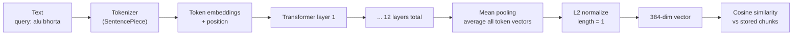
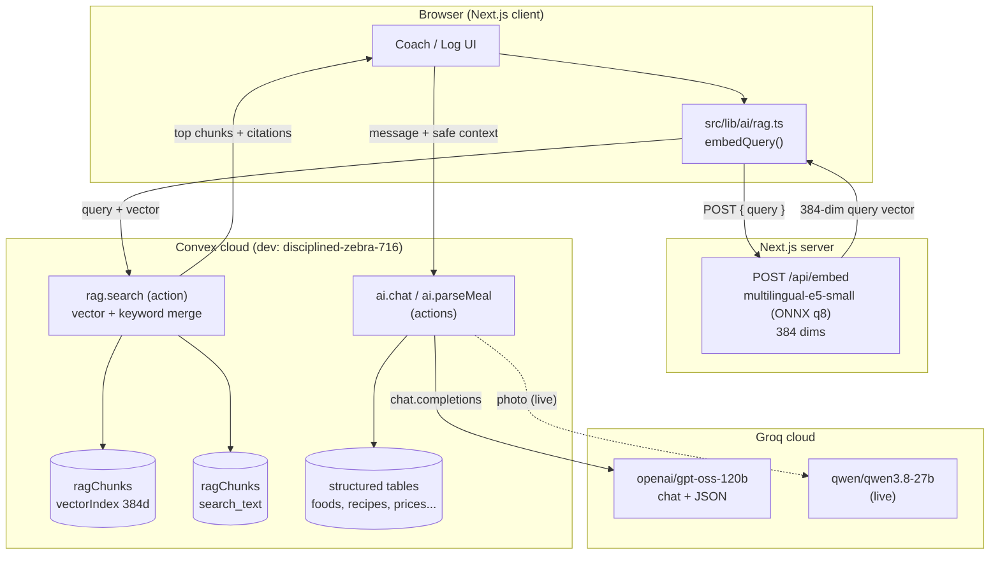
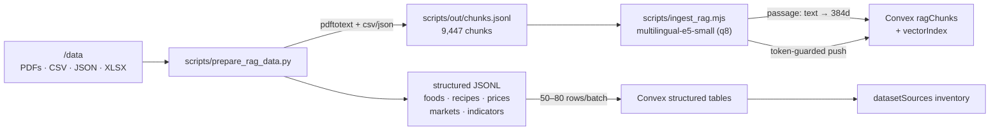
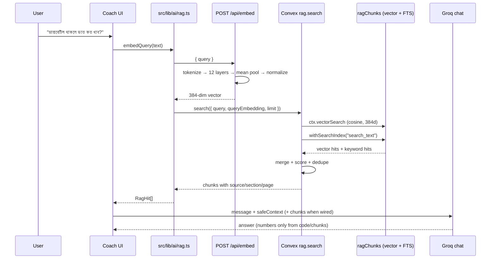
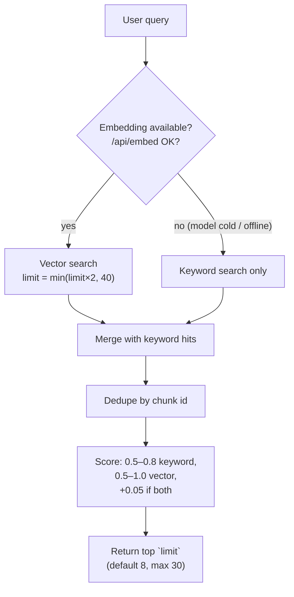
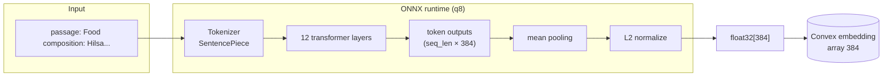

# AI Agent & Model Reference — Deshi Health Companion

**Last updated:** 2026-11-03
**Scope:** every AI/ML call in this repository — the Groq cloud API, the local ONNX embedding model, and the Convex RAG layer that joins them.

> **Naming note:** this project uses **two different kinds of model**.
> - **Groq chat model** (`openai/gpt-oss-120b`) — generates language (answers, JSON picks).
> - **Local embedding model** (`Xenova/multilingual-e5-small`) — does **not** generate text. It converts text to a 384-number vector so the app can search by meaning.
>
> The second one is often called the "local LLM", but technically it is an **embedding / encoder model**, not a generative LLM.

---

## 1. At a glance

| Component | Where it runs | Model | Purpose | Generates text? |
|---|---|---|---|---|
| Chat coach | Convex action → Groq cloud | `openai/gpt-oss-120b` (default) | Friendly Bangla/English/Banglish nutrition answers | ✅ Yes |
| Meal parser | Convex action → Groq cloud | `openai/gpt-oss-120b` (JSON mode) | Pick foods + quantities from a free-text meal line | ✅ JSON only |
| Embeddings (ingestion) | Local Node script | `Xenova/multilingual-e5-small` (ONNX, q8) | Embed 9,447 RAG chunks | ❌ Vectors only |
| Embeddings (query) | Next.js `POST /api/embed` | `Xenova/multilingual-e5-small` (ONNX, q8) | Embed the user's question | ❌ Vector only |
| Vector search | Convex action | — | Cosine similarity over stored vectors | ❌ |
| Keyword search | Convex query | — | Full-text fallback / merge | ❌ |
| Vision | Convex action → Groq cloud | `qwen/qwen3.8-27b` | Plate photo → items + portion class | ✅ JSON live (`ai.analyzePhoto`, assisted) |
| Voice (planned) | Groq cloud | `whisper-large-v3` / `-turbo` | Bangla speech → text | ✅ Transcript (not built yet) |

**Key constraint discovered:** Groq exposes **no embedding endpoint**. Verified on the live key:

```text
GET  https://api.groq.com/openai/v1/models   → 11 models, none are embeddings
POST https://api.groq.com/openai/v1/embeddings
     model=nomic-embed-text-v1_5
     → HTTP 404 {"error":{"message":"The model `nomic-embed-text-v1_5` does not exist..."}}
```

That is why embeddings are computed locally instead of by Groq.

---

## 2. Groq cloud API

### 2.1 Endpoint and auth

| Item | Value |
|---|---|
| Base URL | `https://api.groq.com/openai/v1` |
| Chat endpoint | `POST /chat/completions` |
| Auth | `Authorization: Bearer $GROQ_API_KEY` |
| Key location | **Convex environment only** (`npx convex env set GROQ_API_KEY=...`) — never in client code |
| Chat model | `openai/gpt-oss-120b` (override with `GROQ_MODEL`) |
| Temperature | `0.7` default in `groqChat`, `0.1` for meal parsing |
| Max output | `1024` tokens default, `400` for meal parsing |
| JSON mode | `response_format: { type: "json_object" }` (meal parsing only) |

Code: `convex/ai.ts` → `groqChat()`.

### 2.2 Available Groq models (observed)

```text
openai/gpt-oss-120b
openai/gpt-oss-20b
openai/gpt-oss-safeguard-20b
qwen/qwen3.8-27b
allam-2-7b
whisper-large-v3
whisper-large-v3-turbo
canopylabs/orpheus-v1-english
canopylabs/orpheus-arabic-saudi
meta-llama/llama-prompt-guard-2-22m
meta-llama/llama-prompt-guard-2-86m
```

No `nomic-*`, no `bge-*`, no `text-embedding-*`. Groq is a **chat/vision/speech inference** provider, not an embedding provider.

### 2.3 `ai.chat` — coach action

| Field | Type | Notes |
|---|---|---|
| `message` | `string` | User question in Bangla, English or Banglish |
| `safeContext.mode` | `"normal" \| "restricted" \| "doctor-first"` | Set by the deterministic engine, never by the LLM |
| `safeContext.goal` | `"maintain" \| "gentle-change" \| "build-strength"` | Coarse category only |
| `safeContext.lang` | `string?` | Optional language hint |
| `context` | `{ text, source, section?, page? }[]?` | Up to 6 retrieved RAG excerpts (700 chars each); public corpus only, never PII |
| Returns | `{ response?: string, error?: string }` | Errors are returned, not thrown, so the UI can fall back |

System rules enforced in the prompt (`convex/ai.ts`):

- Warm, practical, shame-free; never "cheat day", "burn off", or "bad food".
- Ground answers in Bangladeshi foods (bhat, dal, mach, dim, ruti, khichuri).
- `doctor-first` / `restricted`: no calorie targets, deficits, or exercise compensation; refer to a doctor or registered dietitian.
- Never invent precise calorie numbers; approximate numbers must be clearly labelled.
- Not a medical device; no diagnosis or medication advice.
- Reply in the user's language.
- When `context` is supplied: use excerpts only when relevant, cite inline with their `[n]` markers, never quote a number that is not in an excerpt.

**Privacy hard rule:** the action never receives age, weight, name or medical conditions. It only gets the message and safe categories (`mode`, `goal`, `lang`).

**RAG grounding (live):** the coach page (`src/app/(app)/coach/page.tsx`) retrieves first — `embedQuery` → `rag.search` (threshold 0.8, top 5) — then calls `ai.chat` with the excerpts. The model marks sources inline as `[1]`, `[2]`; the client parses those markers into citation chips (`source — section` + page). Low/no hits → answer still returned but flagged `lowConfidence`. Stop button invalidates in-flight requests via a request counter.

### 2.4 `ai.parseMeal` — structured meal parsing

| Field | Type | Validation |
|---|---|---|
| `line` | `string` | Trimmed; non-empty; ≤ 500 chars |
| `candidates` | `{ id, nameBn, nameEn, aliases[] }[]` | 1–25 items, supplied by the client from local search |
| `picks[].id` | `string` | Must exactly match a supplied candidate ID |
| `picks[].qty` | `number` | `0 < qty ≤ 20` |
| `picks[].unit` | `string` | Trimmed, ≤ 40 chars; `"default"` when absent |
| Returns | `{ picks?, notes?, error? }` | Invalid picks are dropped, not trusted |

The LLM **never invents foods, grams or calories**. It only chooses from the candidate list and extracts quantity/unit. All gram and kcal math happens in TypeScript (`src/lib/foods/search.ts` → `toLoggedItem`).

### 2.5 `ai.rewriteQuery` — retrieval query rewrite

| Field | Type | Notes |
|---|---|---|
| `query` | `string` | 2–300 chars; search phrase only (no PII) |
| Returns | `{ rewritten?: string, error?: string }` | Plain English search terms, ≤ 12 words |

- Purpose: Bangla/Banglish questions embed poorly against an English-heavy corpus. The rewrite feeds **only the vector pass**; keyword search and the answer language keep the original wording.
- Client triggers it when the query contains Bangla script **or** the first-pass top score < 0.8, then merges both result sets (best score per chunk).
- Model: `openai/gpt-oss-120b`, `temperature: 0`, `maxTokens: 400`.
- **Gotcha:** `gpt-oss` reasons before answering — a 60-token budget was consumed entirely by reasoning (`finish_reason: length`, empty content). Keep `maxTokens ≥ 400` (reasoning ≈ 115 tokens observed).
- Example: `ডায়াবেটিস থাকলে ভাত কত খাব?` → `type 2 diabetes rice portion size`.

### 2.6 Planned AI calls (not implemented)

| Call | Model | Status |
|---|---|---|
| `ai.analyzePhoto` | `qwen/qwen3.8-27b` (JSON mode, ≤3 images/request) | ✅ live; FoodBD gate 49% R / 55% P → assisted |
| Bangla voice input | `whisper-large-v3` / `-turbo` | ⬜ Wave 2/4 (Chrome `bn-BD` only) |
| RAG-grounded answer | Groq chat + retrieved chunks | ✅ live (`context` arg + `[n]` citations) |

---

## 3. Local embedding model — `multilingual-e5-small`

### 3.1 What it is

It is **multilingual-e5-small**, from Microsoft Research's E5 family. `Xenova/multilingual-e5-small` is the same model converted to **ONNX** so it can run in JavaScript through **transformers.js** (`@huggingface/transformers`). It is an encoder, not a chat model.

| Detail | Value |
|---|---|
| Job | Turn text into 384 numbers (an embedding) |
| Languages | ~100, including Bangla |
| Parameters | ~118 million |
| File size | ~470 MB full; ~118 MB quantized (this project uses `dtype: "q8"`) |
| Max input | 512 tokens per text (~300–400 English words; fewer in Bangla because Bangla words often split into more tokens) |
| Output | 384 numbers (L2-normalized) |
| Layers | 12 transformer layers |
| Pooling | Mean pooling over token outputs |
| Distance | Cosine similarity (equivalent to dot product after normalization) |
| Runtime | ONNX Runtime via `@huggingface/transformers` 4.3.x |
| Cache | `.cache/transformers` (git-ignored) |

"Small" is relative: it is tiny next to GPT/Qwen-class models with billions of parameters.

### 3.2 How it works



1. **Tokenizing** — text is split into subword tokens. Bangla words often become several tokens.
2. **Transformer layers** — 12 layers of self-attention let each token look at the others and build context.
3. **Pooling** — average all token outputs into one 384-number vector.
4. **Normalizing** — scale the vector to length 1, so dot product = cosine similarity.
5. **Comparing** — closer vectors mean closer meaning.

It learned this from huge numbers of text pairs (question ↔ answer, translation pairs), so matching pairs end up close and unrelated pairs far apart.

### 3.3 Prefixes matter

The model was trained with task prefixes:

```text
passage: <document text>     ← used when embedding stored chunks
query:   <user question>     ← used when embedding a search query
```

Skipping them noticeably reduces retrieval quality. Both the ingestion script (`scripts/ingest_rag.mjs`) and the query route (`src/app/api/embed/route.ts`) add the correct prefix.

### 3.4 Limits

| Limit | Consequence |
|---|---|
| 512-token cap | Longer text is truncated; the rest is ignored. Chunks are kept around 1,400 characters with 180 overlap to stay under it. |
| Small model | Weaker than `multilingual-e5-base/large` or `bge-m3`, especially on subtle questions. |
| Banglish | Bangla script works reasonably; romanized Bangla is weaker because training data had less of it. |
| Similar ≠ correct | Retrieves related text, cannot fact-check; struggles with negation ("not safe" vs "safe") and exact numbers/doses. |
| Model lock | Every stored vector must come from this exact model *and* variant. Changing model or quantization requires re-embedding all 9,447 chunks. |
| Quantized q8 | Slightly less accurate than full precision; usually a small difference. |
| No generation | It only produces vectors. Answers still come from Groq. |

### 3.5 Compute

- **CPU:** any modern CPU; no GPU needed.
- **RAM:** roughly 300–600 MB while loaded, plus runtime overhead.
- **Disk:** ~118 MB quantized (`.cache/transformers`), up to ~470 MB full.
- **Query latency:** ~20–100 ms once loaded (observed on this laptop: model loads in ~5–14 s cold, then fast).
- **Ingestion:** 9,447 chunks took ~41 minutes on this machine at ~4 chunks/s with 16-text batches; selective re-ingestion of 1,231 chunks took ~83 s at ~15 chunks/s.
- **Serverless caveat:** Vercel struggles with the model file size and cold starts. A small always-on server, container, or local Node process is the practical host.

---

## 4. Working diagrams

### 4.1 System overview



### 4.2 Ingestion pipeline (offline, reproducible)



Steps:

1. `python3 scripts/prepare_rag_data.py` — extracts PDFs, parses CSV/JSON, chunks text, writes `scripts/out/*.jsonl` and `sources.json`.
2. `node scripts/ingest_rag.mjs --fresh` — embeds passages in batches of 16, upserts through `rag.pushChunks` (token-guarded), pushes structured tables.
3. `node scripts/test_rag.mjs "query"` — end-to-end retrieval check.

### 4.3 Query + retrieval sequence



### 4.4 Search fallback logic



### 4.5 Model inference internals



---

## 5. RAG data model

### 5.1 Tables and indexes

| Table | Rows | Indexes |
|---|---:|---|
| `ragChunks` | 9,447 | `by_doc`, `by_source_tag`, `search_text` (full-text, filters `sourceTag`/`lang`), `by_embedding` (vector, 384 dims, filters `sourceTag`/`lang`) |
| `foodFacts` | 913 | `by_key`, `by_category`, `search_name_en`, `search_name_bn` |
| `recipes` | 5,938 | `by_key`, `by_cuisine`, `search_name` |
| `priceObservations` | 34,491 | `by_key`, `by_commodity_and_date`, `by_date`, `search_commodity` |
| `markets` | 171 | `by_market_id` |
| `nutritionIndicators` | 23,746 | `by_key`, `by_dataset_and_item`, `search_item` |
| `datasetSources` | 16 | `by_key` |

### 5.2 Chunk metadata

Every chunk stores:

```ts
{
  docId: string,          // stable source id, e.g. "ndgb-2025"
  chunkIndex: number,     // position within the doc
  sourceTag: "guideline" | "food-table" | "recipe" | "research"
           | "indigenous" | "price" | "faostat" | "market",
  source: string,         // human citation label
  section?: string,       // heading / food / commodity
  page?: number,          // PDF page where available
  lang: "en" | "bn" | "mixed",
  text: string,           // ≤ 8,000 chars, ~1,400 typical
  keywords: string[],
  embedding: number[],    // exactly 384
  url?: string,
  publishedAt?: string
}
```

### 5.3 Corpus composition

| Source | Chunks |
|---|---:|
| Cleaned Indian Food Dataset (5,938 recipes, 150 Bengali) | 5,938 |
| Indian Food Composition Tables 2017 (reference book) | 1,130 |
| Unified food facts (913 foods) | 913 |
| FCTB 2013 reference book | 351 |
| Deshi food alias index (Bangla/Banglish) | 318 |
| National Dietary Guidelines for Bangladesh 2025 | 259 |
| Indigenous food tables (Nayakrishi/Mog, 5 PDFs) | 232 |
| FAOSTAT summaries | 157 |
| WFP monthly price summaries | 73 |
| Mondol & Rahim standardised recipes | 43 |
| Biswas research | 33 |
| **Total** | **9,447** |

### 5.4 Hybrid scoring (as implemented)

- Keyword hits: `0.5 + (1 − index / keywordCount) × 0.3` → range `0.5–0.8`.
- Vector hits: `0.5 + cosineScore × 0.5` → range `0.5–1.0`.
- Both: vector hit gets `+0.05`.
- Results sorted descending, sliced to `limit` (default 8, max 30).

---

## 6. API contracts

### 6.1 `POST /api/embed` (Next.js)

Request:

```json
{ "query": "alu bhorta" }
```

Response (200):

```json
{ "embedding": [0.054, -0.002, ...], "dimensions": 384 }
```

Errors:

| Status | Cause |
|---|---|
| 400 | Invalid JSON, or query length outside 2–500 |
| 500 | Model failed to load / shape mismatch |

Implementation notes:

- Node runtime; model loaded once via a module-level promise. Route declares `maxDuration = 60` for the cold load.
- Cache: `process.cwd()/.cache/transformers`.
- `@huggingface/transformers` + `onnxruntime-node` are externalized in `next.config.ts` (`serverExternalPackages`).
- **Next 16 `cacheComponents` forbids `export const runtime`** in route segments — do not add it back.

### 6.2 `rag.search` (Convex action)

```ts
rag.search({
  query: string,
  queryEmbedding?: number[],   // 384 dims; omit for keyword-only
  sourceTag?: "guideline" | "food-table" | "recipe" | "research"
           | "indigenous" | "price" | "faostat" | "market",
  lang?: "en" | "bn" | "mixed",
  limit?: number               // default 8, max 30
})
```

Returns `{ id, text, source, sourceTag, section?, page?, lang, url?, score }[]`.

### 6.3 `rag.keywordSearch` (Convex query)

Same result shape; no embedding needed. `limit` defaults to 8, max 50. Useful as a guaranteed fallback when the model is unavailable or the deployment is cold.

### 6.4 Ingest mutations (token-guarded)

| Function | Batch | Notes |
|---|---:|---|
| `rag.pushChunks` | ≤ 100 | Validates 384 dims and text ≤ 8,000 chars; `mode: "insert"` for bulk, default upsert |
| `rag.clearChunks` | ≤ 400 deletes | Optional `docId`; used by `--fresh` |
| `rag.pushRecipes` | ≤ 100 | Upsert by `key` |
| `rag.pushFoodFacts` | ≤ 100 | Upsert by `key` |
| `rag.pushPrices` | ≤ 100 | Upsert by `key` |
| `rag.pushMarkets` | ≤ 100 | Upsert by `marketId` |
| `rag.pushIndicators` | ≤ 100 | Upsert by `key` |
| `rag.pushSources` | ≤ 100 | Upsert by `key` |

All require `token` to equal `process.env.RAG_INGEST_TOKEN`.

### 6.5 `ai.chat` / `ai.parseMeal` / `ai.rewriteQuery`

See §2.3, §2.4 and §2.5. All three return `{ error }` instead of throwing, so the UI can fall back without crashing.

```ts
await chatAction({
  message: "ডায়াবেটিস থাকলে ভাত কত খাব?",
  safeContext: { mode: "normal", goal: "maintain", lang: "bn" },
  context: [{ text: "...", source: "National Dietary Guidelines...", section: "...", page: 90 }],
});
// → { response: "... [1] ..." }  → client parses [1] into a citation chip
```

---

## 7. Environment variables

| Variable | Where | Required | Purpose |
|---|---|---|---|
| `GROQ_API_KEY` | Convex env | ✅ for AI | Groq bearer token (`gsk_...`) |
| `GROQ_MODEL` | Convex env | optional | Chat model override (default `openai/gpt-oss-120b`) |
| `RAG_INGEST_TOKEN` | Convex env + `.env.local` | ✅ for ingestion | Guards push/clear mutations; not needed for search |
| `NEXT_PUBLIC_CONVEX_URL` | `.env.local` | ✅ | Convex client URL |
| `CONVEX_DEPLOYMENT` | `.env.local` | ✅ | Convex deployment selector |

`GROQ_EMBED_MODEL` and `nomic-embed-text-v1_5` are **not used** — Groq has no embedding endpoint.

---

## 8. Operational runbook

```bash
# 1. Rebuild the corpus after changing /data
python3 scripts/prepare_rag_data.py

# 2. Embed + push (refuses to duplicate unless --fresh)
node scripts/ingest_rag.mjs --fresh

# 3. Selective re-ingest (e.g. after fixing food categories)
node scripts/ingest_rag.mjs --skip-structured --docs food-facts,food-aliases

# 4. Retrieval smoke tests
node scripts/test_rag.mjs "alu bhorta" "type 2 diabetes carbohydrate rice portion"

# 5. Check inventory
bunx convex run rag:sources '{}'
```

**Re-ingest rules**

- Changing the embedding model or quantization → re-embed **all** chunks (`--fresh`).
- Changing only text/metadata for some docs → `--skip-structured --docs <docIds>` (upsert mode).
- Never run ingestion without `--fresh` on a populated corpus; the script aborts to prevent duplicates.

---

## 9. Current integration status

| Piece | Status |
|---|---|
| Groq chat action | ✅ `ai.chat` live (privacy-safe prompt) |
| Groq meal parser | ✅ `ai.parseMeal` live, validated, offline fallback in `/log` |
| Local embedding route | ✅ `/api/embed` live (384 dims, Bangla verified) |
| RAG corpus | ✅ 9,447 chunks embedded on dev |
| Hybrid retrieval | ✅ `rag.search` + `rag.keywordSearch` live |
| Coach uses RAG chunks | ✅ wired — embed → `rag.search` (≥0.8, top 5) → `ai.chat` context |
| Citation UI | ✅ `[n]` markers parsed into `CitationChip`s (source — section, p.N) |
| Query rewrite (Bangla → English) | ✅ `ai.rewriteQuery` + merged second search (Bangla script or score < 0.8) |
| Photo vision | ✅ `ai.analyzePhoto` live (FoodBD-gated, assisted mode) |
| Voice | ⬜ Planned — Whisper |

### Known retrieval quality notes

- Bangla/Banglish food names work well after the alias index: `alu bhorta` → 0.982, `ভর্তা` → 0.977.
- Bangla *medical* questions rank food aliases first (`ডায়াবেটিস থাকলে ভাত কত খাব?` → panta bhat/dal bhat at 0.966, guideline only #4). Mitigated by `ai.rewriteQuery`: merged results now include 3 NDGB pages (p.88/91/105) in the top 5 — see `scripts/test_rag_rewrite.mjs`.
- `rice-glycaemic-index-bau.pdf` is a scanned PDF with no text layer; it is the only `/data` source not in the corpus.

---

## 10. Privacy and safety rules

1. **Never send PII to Groq:** no name, age, weight, height, conditions, or profile IDs. Only meal text, questions, photos, and code-set safe categories.
2. **Numbers never come from the LLM:** grams and kcal are computed in `src/lib/engine` and `src/lib/foods`; the LLM may only choose from candidates or quote retrieved chunks.
3. **Safety modes are server-side:** `normal` / `restricted` / `doctor-first` are derived by the engine, not accepted from the LLM.
4. **No diagnosis, no medication advice:** refusal + safer alternative + referral.
5. **Citations:** every RAG answer should carry `source`, `section`, and `page`.
6. **Refuse low-confidence retrieval:** below the tuned threshold, say so and suggest a professional.

---

## 11. File map

| Path | Role |
|---|---|
| `convex/ai.ts` | Groq client (`groqChat`), `ai.chat`, `ai.parseMeal` |
| `convex/rag.ts` | `rag.search`, `rag.keywordSearch`, ingest mutations, `rag.sources` |
| `convex/schema.ts` | `ragChunks` (search + vector indexes), structured tables |
| `src/app/api/embed/route.ts` | Local ONNX embedding endpoint |
| `src/lib/ai/rag.ts` | `embedQuery()`, `RagHit`, `citationLabel()` |
| `scripts/prepare_rag_data.py` | PDF/CSV/JSON → chunks + structured JSONL |
| `scripts/ingest_rag.mjs` | Local embedding + batched Convex push |
| `scripts/test_rag.mjs` | End-to-end retrieval smoke test |
| `scripts/test_rag_rewrite.mjs` | Simulates coach flow: original + rewritten embeddings, merged |
| `next.config.ts` | `serverExternalPackages` for transformers/onnxruntime |
| `.cache/transformers/` | Cached ONNX model files (git-ignored) |
| `data/` | Source datasets and provenance inventory |

---

## 12. Troubleshooting

| Symptom | Cause | Fix |
|---|---|---|
| `GROQ_API_KEY is not set` | Missing Convex env | `npx convex env set GROQ_API_KEY=<key>` |
| Groq 401 | Bad/rotated key | Set a valid key |
| Groq 404 on embeddings | Groq has no embeddings | Use the local model; do not call `/v1/embeddings` |
| `/api/embed` 500 | Model download/cache missing | Check `.cache/transformers`; allow network on first run |
| `ragChunks already has ~N chunks` | Re-running ingestion | Add `--fresh` (destructive) or use `--docs` for selective upsert |
| `ai.rewriteQuery` returns empty content | `gpt-oss` reasoning ate the token budget | Keep `maxTokens ≥ 400` (reasoning ≈ 115 tokens) |
| Bangla medical query ranks aliases first | Cross-lingual gap | Handled: `ai.rewriteQuery` + merged second search |
| Vector search returns nothing | Index not populated or wrong dims | Verify `rag.sources` and that embeddings are 384 dims |
| Build error: `Route segment config "runtime"` | Next 16 `cacheComponents` | Remove `export const runtime` from route files |
| Ingestion stops mid-run | Network/process interruption | Re-run with `--fresh` (clears partial chunks first) |
