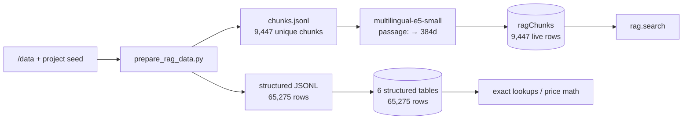

# RAG Database — Inventory, Quality & Provenance

**Snapshot:** 2026-11-03 — verified **post-D1-fix**: 9,447 chunks, 0 duplicate keys
**Deployment:** `dev` — `disciplined-zebra-716` (`https://disciplined-zebra-716.ap-southeast-2.convex.cloud`)
**Embedding model:** `Xenova/multilingual-e5-small` (ONNX, q8, 384 dims)
**Corpus built:** `python3 scripts/prepare_rag_data.py` → `node scripts/ingest_rag.mjs --fresh`

This file records exactly what was pushed into the RAG system: how many rows, from which source, how clean it is, and what is known to be wrong.

---

## 1. What "pushed" means here

Three stores are written:

| Store | Table | Purpose |
|---|---|---|
| Vector + full-text chunks | `ragChunks` | Retrieved by `rag.search`; one row per chunk + 384-dim embedding |
| Structured facts | `foodFacts`, `recipes`, `priceObservations`, `markets`, `nutritionIndicators` | Exact lookups, app data, price math |
| Inventory | `datasetSources` | One row per source: records, chunk count, notes, ingest time |

`foods` (318 rows) is the app's local alias/search seed, **not** a RAG table.



---

## 2. Quantity

### 2.1 Live totals

| Table | Live rows | Notes |
|---|---:|---|
| `ragChunks` | **9,447** | 0 duplicate keys (D1 fixed); 21 content-overlap dups remain (D2) |
| `foodFacts` | 913 | 100% macro/micro fields populated |
| `recipes` | 5,938 | 5,938 with ingredients, instructions, URL, minutes |
| `priceObservations` | 34,491 | 1900–2026, 73 commodities, 124 markets |
| `markets` | 171 | 124 markets appear in price rows |
| `nutritionIndicators` | 23,746 | 2000–2025, no missing values |
| `datasetSources` | 16 | source inventory |
| **Structured subtotal** | **65,275** | (65,259 data rows + 16 source rows) |
| **RAG + structured** | **74,722** | 9,447 chunks + 65,275 structured rows |
| `foods` (not RAG) | 318 | app-side alias/search seed |

**Row reconciliation**

```text
9,129  initial full ingest (no alias chunks)
+ 318  alias index pushed in the selective re-ingest
= 9,447 unique chunks = live ragChunks (D1 duplicates removed 2026-11-03)
```

### 2.2 Chunks by source

| Doc ID | Source | Tag | Pages | Intended chunks | Live rows | Dups |
|---|---|---|---:|---:|---:|---:|
| `recipes-corpus` | Cleaned Indian Food Dataset (Archana's Kitchen, Kaggle) | recipe | — | 5,938 | 5,938 | 0 |
| `ifct-2017-book` | Indian Food Composition Tables 2017 | food-table | 550 | 1,130 | 1,130 | 0 |
| `food-facts` | Unified food facts (FCTB + IFCT) | food-table | — | 913 | 913 | 0 |
| `fctb-2013-book` | Food Composition Table for Bangladesh 2013 | food-table | 180 | 351 | 351 | 0 |
| `food-aliases` | Deshi food alias index (project seed) | food-table | — | 318 | 318 | 0 |
| `ndgb-2025` | National Dietary Guidelines for Bangladesh 2025 | guideline | 129 | 259 | 259 | 0 |
| `faostat-balance` | FAOSTAT food balance | faostat | — | 114 | 114 | 0 |
| `cine-...veg_leafy_veg` | Indigenous vegetables & leafy greens (Nayakrishi/CINE) | indigenous | 69 | 107 | 107 | 0 |
| `wfp-prices` | WFP monthly food price summaries | price | — | 73 | 73 | 0 |
| `cine-...fruits` | Indigenous fruits (Nayakrishi/CINE) | indigenous | 34 | 46 | 46 | 0 |
| `mondol-rahim-2025` | Traditional Bangladeshi curries (Mondol & Rahim) | research | 11 | 43 | 43 | 0 |
| `cine-...fish_seafood` | Indigenous fish & seafood (Nayakrishi/CINE) | indigenous | 32 | 43 | 43 | 0 |
| `faostat-security` | FAOSTAT food security | faostat | — | 42 | 42 | 0 |
| `biswas` | Bangladesh food composition research (Biswas) | research | 11 | 33 | 33 | 0 |
| `cine-...animals_birds_dairy` | Indigenous animals, birds & dairy (Nayakrishi/CINE) | indigenous | 17 | 22 | 22 | 0 |
| `cine-...cereal_grains_pulses` | Indigenous cereals, grains & pulses (Nayakrishi/CINE) | indigenous | 13 | 14 | 14 | 0 |
| `faostat-affordability` | FAOSTAT affordability series | faostat | — | 1 | 1 | 0 |
| **Total** | | | **1,046** | **9,447** | **9,447** | **0** |

> 17 doc IDs map to 16 `datasetSources` rows: FAOSTAT is split into `faostat-balance`, `faostat-security`, and `faostat-affordability`, while `wfp-markets` has structured rows but no chunks. `datasetSources.chunkCount` matches the live count again after the D1 fix.

### 2.3 Chunks by tag (live)

| Tag | Rows | Share | What it is |
|---|---:|---:|---|
| `recipe` | 5,938 | 62.9% | Recipe text, mostly Indian/continental |
| `food-table` | 2,712 | 28.7% | Composition facts, aliases, table books |
| `guideline` | 259 | 2.7% | Bangladesh dietary guidelines |
| `indigenous` | 232 | 2.5% | Nayakrishi/CINE community food tables |
| `faostat` | 157 | 1.7% | National food balance / security |
| `research` | 76 | 0.8% | Two small research PDFs |
| `price` | 73 | 0.8% | Monthly retail price summaries |
| `market` | 0 | — | Structured only (`markets`) |

### 2.4 Chunk size distribution

| Metric | Value |
|---|---|
| Minimum | 92 chars |
| Median | 1,326 chars |
| p90 | 1,693 chars |
| p99 | 1,987 chars |
| Maximum | 2,281 chars |
| Chunks < 100 chars | 1 |
| Chunks > 2,000 chars | 80 |

Chunks are built with a page-first sliding window (~1,400 chars, 180 overlap). English text at 2,000+ chars can exceed the model's **512-token** cap; Bangla expands to more tokens per character, so Bangla-heavy chunks may truncate.

---

## 3. Sources and authority

| Tier | Sources | Why |
|---|---|---|
| **A — Bangladesh primary** | NDGB 2025 · FCTB 2013 · food facts · alias index · CINE indigenous tables · Mondol & Rahim · Biswas · WFP prices/markets | Official Bangladesh guidance, Bangladesh composition data, or locally curated |
| **B — regional reference** | IFCT 2017 (India) · FAOSTAT | Strong nutrition data, but not Bangladesh-specific; useful for coverage |
| **C — contextual only** | Recipe corpus (Archana's Kitchen, Kaggle) | Good for dish names/ingredients; **not** for calorie or nutrient truth |

### 3.1 Per-source notes

- **NDGB 2025** — cleanest and most important corpus. 129 pages, 259 chunks. Covers diabetes, water, healthy plate, life-stage guidance. English only.
- **FCTB 2013** — Bangladesh-specific food composition. 180 pages, 351 chunks. Table-heavy; extraction noise possible.
- **IFCT 2017** — 550 pages, 1,130 chunks. Largest composition reference; covers foods not in FCTB. India-specific, so use as regional fallback.
- **Food facts (913)** — deduplicated from FCTB (381) + regional tables (532). 100% of kcal/protein/fat/carb/fibre/calcium/iron/sodium/zinc/vitamin A/vitamin C populated. 764 have scientific names; only 778 have a non-empty Bangla name.
- **Alias index (318)** — Bangla + Banglish names and household portions. The strongest bridge for vernacular queries; covers ~35% of the 913 foods.
- **CINE indigenous (232)** — five community food-system tables (vegetables, fruits, cereals, animals, fish). Niche but unique.
- **Research (76)** — Mondol & Rahim curry composition (43) and Biswas (33). Small but Bangladesh-specific.
- **Recipes (5,938)** — 150 Bengali recipes (2.5%), 952 Continental, 927 Indian, 763 North Indian, 558 South Indian. English instructions. Dominates the corpus by volume.
- **WFP prices (73 chunks + 34,491 rows)** — 73 monthly commodity summaries; exact prices live in `priceObservations`. 29,303 rows from 2020+, 14,857 from 2025+; 37 rows predate 2000.
- **FAOSTAT (157 chunks + 23,746 rows)** — national food balance (22,706), food security (1,007), affordability (33). Aggregates, not per-food values.
- **WFP markets (171 rows, 0 chunks)** — geography metadata only.

---

## 4. Quality

### 4.1 Metadata coverage (live chunks)

| Field | Coverage | Note |
|---|---:|---|
| `keywords` | 9,447 / 9,447 (100%) | Always populated |
| `section` | 9,447 / 9,447 (100%) | Always populated |
| `page` | 2,048 / 9,447 (21.7%) | PDF sources only |
| `url` | 5,938 / 9,447 (62.9%) | Recipes only |
| `publishedAt` | 1,783 / 9,447 (18.9%) | Partial |
| `license` (source level) | 0 / 16 (0%) | **Gap** |
| `embedding` | 9,447 / 9,447 | All exactly 384 dims |
| `lang = en` | 8,351 (88.4%) | |
| `lang = mixed` | 1,096 (11.6%) | Aliases + food facts |
| `lang = bn` | **0 (0%)** | No pure-Bangla chunks |

### 4.2 Retrieval evidence (live, 2026-11-03)

| Query | Top score | Top hit | Verdict |
|---|---:|---|---|
| `alu bhorta` | 0.982 | Alias: আলুর ভর্তা (145 kcal/100g) | ✅ correct |
| `ভর্তা` | 0.959 | Alias: dim bhorta | ⚠️ relevant but ambiguous (generic mash) |
| `protein in hilsa` | 0.995 | IFCT Hilsa (21.8 g protein) | ✅ correct, distinct hits (post-D1-fix) |
| `type 2 diabetes carbohydrate rice portion` | 0.993 | NDGB p.90 | ✅ correct |
| `price of rice` | 1.004 | WFP rice (2024–2025) | ✅ correct |
| `how much water should I drink` | 1.003 | NDGB p.46 | ✅ correct |
| `roti calories` | 0.934 | FCTB Ruti (246 kcal) | ✅ correct; #2–#3 noisy |
| `kichuri` | 0.927 | FCTB Khichuri (163 kcal) | ✅ correct |

- 8/8 top-1 results were relevant; 3/8 had noisy runners-up.
- Scores can exceed 1.0 because the merge adds `+0.05` when a chunk is both a keyword and vector hit (max ~1.05).
- Bangla keyword search works through aliases: `ভাত` and `bhorta` return alias chunks; `diabetes` returns NDGB pages.
- **Bangla medical query + English rewrite merge** (`node scripts/test_rag_rewrite.mjs`): `ডায়াবেটিস থাকলে ভাত কত খাব?` → rewrite `type 2 diabetes rice portion size`; merged top-5 = 2 aliases + 3 NDGB pages (p.88/91/105) vs only 1 guideline page before.
- **Wave 5 gate** (`node scripts/eval_wave5.mjs`): 20/20 questions returned the expected source in top-5 after narrow source-intent routing for explicit indigenous/healthy-plate requests; 10/10 unsafe prompts redirected safely.

### 4.3 Strengths

1. **Bangladesh-specific core is strong**: NDGB, FCTB, 913 food facts, 318 aliases, CINE tables.
2. **Complete nutrient fields** for all 913 food facts.
3. **Bangla/Banglish entry point** via aliases, verified by retrieval.
4. **Large, fresh price history**: 34,491 observations, 14,857 from 2025+.
5. **Every chunk is embedded and keyword-tagged**; no partial rows.
6. **Guideline retrieval is precise** for diabetes, water, and portion questions.

### 4.4 Weaknesses

1. **Recipe skew**: 60% of chunks are recipes, but only 2.5% are Bengali; recipe text can outrank deshi food facts.
2. **No pure-Bangla chunks**: Bangla works only cross-lingually or through the 318 aliases. Mitigated for medical queries by `ai.rewriteQuery` (Bangla → English vector pass) — see §4.2.
3. **PDF table noise**: 1,100 of 1,481 book chunks (74.3%) are digit-heavy table dumps with low semantic value (e.g. amino-acid runs).
4. **Coverage gaps**: 135 food facts lack a Bangla name; aliases cover ~35% of foods; the scanned `rice-glycaemic-index-bau.pdf` has no text layer and is excluded.
5. **Provenance gaps**: all 16 sources have `license: null`; URLs exist only for recipes.
6. **Price units are not normalized**: `KG`, `L`, `1 piece`, `500 G`, `100 KG` (wholesale) coexist.
7. **Stale price rows**: 37 observations predate 2000.
8. **Long chunks**: 80 exceed 2,000 chars and risk the 512-token cap.
9. **Duplicate rows**: 21 chunk-overlap duplicates remain (D2). The 413 structural duplicates (D1) were fixed on 2026-11-03.

### 4.5 Known data defects

#### D1 — 413 duplicate `food-facts` chunks — ✅ FIXED (2026-11-03)

- **Was:** live `ragChunks` had 9,860 rows (9,447 unique + 413 duplicates); `food-facts` had 1,326 rows; chunk indices 500–912 were duplicated. `protein in hilsa` returned the same IFCT chunk twice (0.995, 0.993).
- **Root cause:** `convex/rag.ts` → `pushChunks` loaded only `take(500)` rows per `docId` when upserting. Re-ingesting the 913-row `food-facts` doc found indices 0–499 but not 500–912, so it inserted those again.
- **Fix applied:** added `ragChunks.by_doc_chunk` index on `["docId", "chunkIndex"]`; `pushChunks` now does a point lookup per chunk and deletes any extra rows sharing the same key (self-healing). Then re-pushed `food-facts` (`--skip-structured --docs food-facts`, 913 chunks, 65s).
- **Verified:** `ragChunks` = 9,447 rows; 0 duplicate `(docId, chunkIndex)` keys; all embeddings 384 dims; `protein in hilsa` returns distinct hits.

#### D2 — 21 exact-duplicate chunks in the prepared corpus

- Caused by the 180-character page overlap when a page boundary contains very little text (mostly IFCT/FCTB table fragments).
- Low impact (0.2%), but can waste a retrieval slot.

#### D3 — Extraction noise

- Example: `u; M. Kash. Oalu; Kh. U phan; Kon., Alu; ...` (IFCT p.516) and numeric runs like `060 20.6 760 1434 ...` (FCTB p.166).
- These are raw table pages. They are useful as a last-resort reference but poor semantic matches.

#### D4 — Missing Bangla names

- 135 / 913 food facts have an empty `nameBn` (14.8%).
- Bangla coverage therefore depends on the 318 alias rows, not on the full food table.

#### D5 — Scanned PDF excluded

- `data/rice-glycaemic-index-bau.pdf` is image-only; `pdftotext` yields no text. Glycaemic-index questions have no dedicated source.

#### D6 — Language detection has no `bn` bucket

- All chunks are classified `en` or `mixed`; 100% Bangla text was never detected. The detector is conservative, so treat `lang` as advisory.

#### D7 — Price normalization

- Wholesale rows use `100 KG` while retail uses `KG`, `L`, `1 piece`, `500 G`.
- Any comparison UI must normalize to BDT/kg or BDT/litre first.

---

## 5. How the data was pushed

### 5.1 Pipeline

```bash
# 1. Extract + chunk + classify (writes scripts/out/*.jsonl)
python3 scripts/prepare_rag_data.py

# 2. Embed locally and push (fresh run: clears old chunks first)
node scripts/ingest_rag.mjs --fresh

# 3. Selective re-ingest (upsert; used after alias/category fixes)
node scripts/ingest_rag.mjs --skip-structured --docs food-facts,food-aliases
```

### 5.2 Embedding and push parameters

| Parameter | Value |
|---|---|
| Model | `Xenova/multilingual-e5-small`, dtype `q8` |
| Passage prefix | `passage: ` |
| Query prefix | `query: ` (in `/api/embed`) |
| Dimensions | 384 |
| Batch size | 16 texts for embedding; 100 chunks per Convex mutation |
| Structured batch | 50–80 rows per mutation |
| Chunk mode | `insert` for fresh bulk, `upsert` for selective |
| Auth | `RAG_INGEST_TOKEN` on every push/clear |
| Idempotency key | `(docId, chunkIndex)` via `by_doc_chunk` point lookup (D1 fixed; also deletes duplicate keys on upsert) |

### 5.3 Observed run times

| Run | Rows | Time | Rate |
|---|---:|---:|---:|
| Full ingest (structured + 9,129 chunks) | 9,129 chunks + 65,259 data rows | ~41 min (2,462 s) | ~4.4 chunks/s |
| Selective re-ingest (facts + aliases) | 1,231 chunks | ~83 s | ~15 chunks/s |
| Structured push (recipes) | 5,938 rows | ~58 s | ~103 rows/s |
| Structured push (prices) | 34,491 rows | ~182 s | ~190 rows/s |
| Structured push (indicators) | 23,746 rows | ~123 s | ~194 rows/s |

The bottleneck is local ONNX embedding, not Convex writes.

---

## 6. How to audit this snapshot

```bash
# Source inventory (16 rows)
CONVEX_TMPDIR="$PWD/.tmp" npx convex run rag:sources '{}'

# Count chunks (max 10,000 per call)
CONVEX_TMPDIR="$PWD/.tmp" npx convex data ragChunks --limit 10000 --format jsonl | wc -l

# Full export for exact counts (recommended for > 10k rows)
CONVEX_TMPDIR="$PWD/.tmp" npx convex export --path /tmp/rag-snapshot.zip
cd /tmp && unzip -q rag-snapshot.zip -d rag-snapshot
for d in rag-snapshot/*/; do t=$(basename "$d"); [ -f "$d/documents.jsonl" ] && echo "$t $(grep -c '' "$d/documents.jsonl")"; done

# Retrieval quality probes
node scripts/test_rag.mjs "alu bhorta" "protein in hilsa" "type 2 diabetes carbohydrate rice portion" "price of rice"

# Keyword-only fallback
CONVEX_TMPDIR="$PWD/.tmp" npx convex run rag:keywordSearch '{"query":"bhorta","limit":3}'
```

Expected snapshot values:

```text
ragChunks            9,447
foodFacts              913
recipes              5,938
priceObservations   34,491
markets                171
nutritionIndicators 23,746
datasetSources          16
```

---

## 7. Recommendations, in priority order

1. ~~Fix D1~~ — done 2026-11-03 (index + self-healing upsert; `ragChunks` = 9,447, 0 dup keys).
2. **Add Bangla coverage** — Bangla names for the 135 missing foods; Bangla summaries for the top NDGB sections; expand aliases beyond 35%.
3. **Rerank or quota the recipe corpus** — 60% of chunks are recipes; cap recipe hits or boost `guideline`/`food-table` for nutrition questions.
4. **Normalize prices** — store `pricePerKgBDT` / `pricePerLitreBDT`; filter pre-2020 rows from retrieval.
5. **Reduce table noise** — skip pure numeric/amino-acid pages or store them as structured data instead of chunks.
6. **Fill provenance** — `license`, `url`, `publishedAt` for every source.
7. **Handle the scanned PDF** — OCR `rice-glycaemic-index-bau.pdf` if GI answers are needed.
8. **Split long chunks** — keep every chunk under ~1,200 chars so Bangla stays inside 512 tokens.
9. **Add a `rag.stats` query** — row counts, per-tag counts, duplicate count, embedding-dim check in one call.
