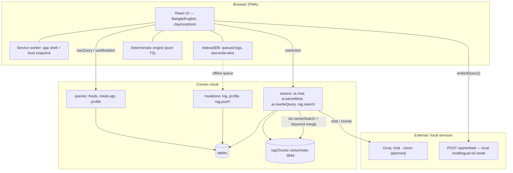

# Deshi Health Companion: A Privacy-First, Deterministic-and-RAG Nutrition System for Bangladesh

**A conference-style system paper**

*Team HabitForge — YUNet AIgnite Buildathon 2026*
*Draft: 3 November 2026 · Status: working system on Convex dev deployment*

---

## Abstract

Bangladesh carries one of South Asia's highest diabetes burdens (13.2% of adults, IDF 2024) yet its users rely on global calorie trackers that lack Bangla language, Bangladeshi foods, and local dietary guidance. We present **Deshi Health Companion**, a web/PWA nutrition companion built on a strict separation of concerns: *structured data owns numbers, a deterministic engine owns decisions, a retrieval-augmented language model owns words.* The system computes energy budgets, safety gates, and food mathematics exclusively in typed, unit-tested TypeScript; a large language model (LLM) never sets a number and never receives personal identifiers — only the user's message and coarse, code-derived safety categories. A Bangladesh-first knowledge base of **9,447 text chunks** drawn from 16 sources (national dietary guidelines, food-composition tables, indigenous food tables, research papers, and market-price series) is embedded locally with a 384-dimensional multilingual E5 model and searched with a hybrid vector–keyword retriever. Because the hosting LLM provider exposes no embedding endpoint, query embeddings run in-process on commodity CPUs. A Groq-powered query rewrite closes the Bangla→English cross-lingual gap for medical questions. We report retrieval quality on eight probe queries (8/8 top-1 relevance), a 53-test deterministic engine suite, and a full production build. Limitations — recipe-corpus skew, no pure-Bangla chunks, and extraction noise — are quantified from a live data audit.

**Keywords:** nutrition, RAG, multilingual embeddings, Bangla, safety-critical LLM, Convex, low-resource languages

---

## 1. Introduction

### 1.1 Motivation

Three facts shape the design space for a Bangladeshi nutrition product:

1. **Disease burden.** The 2024 IDF report places diabetes at 13.2% of adults aged 20–79 in Bangladesh — second-highest in South Asia [17]. South Asian diets are carbohydrate-dense (rice ≈ 630 g/day in 21-country cohort data), and Western BMI cut-offs under-warn for South Asian body composition [18].
2. **Recent, official guidance exists.** The *National Dietary Guidelines for Bangladesh* (NNS/WHO/FAO, August 2025) provides a healthy plate, food-exchange lists, and disease-specific chapters — an ideal, citable retrieval corpus [1].
3. **No local product.** Bangladeshi users install global apps (MyFitnessPal, Cal AI, Fastic); India's HealthifyMe treats "Bengali" as one region among many. Nothing serves Bangla language, Bangladeshi home cooking, taka prices, and local safety context [18].

Calorie advice is also **safety-critical**: deficits and "burn it off" messaging can harm users with diabetes, eating disorders, or low BMI. A responsible AI layer is therefore a product requirement, not a polish item.

### 1.2 Design principles

The architecture follows one rule, adopted from the project research [18]:

> **Structured data for numbers · RAG for knowledge · LLM for language.**

Concretely:

- **P1 — Determinism for decisions.** BMR/TDEE, budgets, safety modes, and gram/kcal math live in pure TypeScript (`src/lib/engine/`, `src/lib/foods/`), shared by browser and server, tested by 53 unit/property tests. No LLM call can change a number.
- **P2 — Citations or silence.** Every knowledge answer must trace to a retrieved chunk with `source`, `section`, and `page`; below a similarity threshold the system says it does not have a reference rather than improvising.
- **P3 — Privacy by construction.** The LLM receives only the user's question text and code-set categories (`mode`, `goal`, `lang`). Name, age, weight, and conditions never leave the deterministic layer.
- **P4 — Vernacular first.** Bangla, English, and Banglish are first-class inputs; food aliases and a query-rewrite path exist specifically for them.
- **P5 — Local-first embeddings.** No second paid API key: query and passage embeddings run on a quantized ONNX model on ordinary CPUs.

### 1.3 Contributions

1. A **safety-gated deterministic engine** (Mifflin-St Jeor BMR, adaptive TDEE, 7-day banking budget, three safety modes) shared across client and Convex, with 53 passing tests.
2. A **candidate-constrained meal parser**: the LLM may only select from ≤25 client-supplied foods and extract quantities; all math is code-side.
3. A **Bangladesh-first RAG corpus**: 9,447 chunks + 65,275 structured rows from 16 audited sources, with per-source provenance, quality tiers, and a published defect ledger.
4. A **local multilingual retrieval stack**: `multilingual-e5-small` (384-d, ONNX q8) embedded in the app server, hybrid vector–keyword search on Convex, and a Groq query rewrite that lifts Bangla medical queries from 1 to 3 guideline pages in the top-5.
5. A **citation protocol** between LLM and UI: inline `[n]` markers parsed into source chips, with a low-confidence flag when retrieval fails.

---

## 2. Related Work

Commercial trackers (MyFitnessPal, Lose It!, MacroFactor) provide barcode-scale food databases and adaptive energy expenditure, but no Bangla interface and no Bangladeshi food depth; MacroFactor's adaptive TDEE [18] directly inspired our §4.3 estimator. Regional products (HealthifyMe, Indian FCT-based apps) prove demand for local-food tracking but price in rupees and treat Bengali as a sub-region [18]. Retrieval-augmented generation [19] is now standard for grounding LLMs, and multilingual dual-encoder models such as E5 [10] make cross-lingual retrieval feasible without per-language training. Unlike these systems, ours couples RAG with a *deterministic safety layer that precedes the LLM* — the model cannot override clinical gates because it never sees the data that would let it. We are unaware of a published nutrition system that combines Bangla/Banglish parsing, an official national guideline corpus, and a no-PII LLM boundary in one deployable stack.

---

## 3. System Overview

### 3.1 Architecture



*Figure 1 — Three-plane architecture: client plane (UI + deterministic engine + offline stores), Convex plane (state, retrieval, actions), and service plane (Groq LLM, local embeddings).*

### 3.2 Layer responsibilities

| Layer | Owns | Must never own | Implementation |
|---|---|---|---|
| Structured food DB | kcal, macros, household measures, aliases, prices | prose answers | Convex `foods` (318) + bundled seed |
| Deterministic engine | BMR/TDEE, budgets, `safetyMode`, rebalance, shared-pot grams | free text | `src/lib/engine/`, `src/lib/foods/` — 53 tests |
| Vector store | guidelines, composition tables, recipes, prices | personal data | `ragChunks` (9,447 × 384-d) + 5 structured tables |
| LLM (Groq) | understanding, candidate selection, friendly explanation, citations | **any number, any PII** | `convex/ai.ts` → `groqChat()` |
| Embeddings (local) | passage/query vectors | network calls to paid APIs | `POST /api/embed` (ONNX, q8) |

**Table 1 — Layer responsibilities and prohibitions.**

### 3.3 Stack

Next.js 16 (App Router, `cacheComponents`), React 19, Tailwind 4, Bun 1.4, Convex 1.49 (tables, reactive queries, actions, vector + full-text indexes), Groq OpenAI-compatible REST, `@huggingface/transformers` 4.3 + onnxruntime-node, lucide-react. Frontend deploys to Vercel; backend to Convex. Offline: service worker caches the app shell and food snapshot; logs queue in IndexedDB with last-write-wins semantics.

---

## 4. Deterministic Nutrition Engine

All formulas are pure functions with unit and property tests; the same module runs in the browser and inside Convex actions.

### 4.1 Energy formulas

- **BMR (Mifflin-St Jeor)** [16]: men `10·kg + 6.25·cm − 5·age + 5`; women `… − 161`.
- **Formula TDEE** = BMR × activity factor, superseded over time by the adaptive estimate (§4.3).
- **Exercise energy**: `kcal = MET × kg × hours`; planning uses the *net* form `(MET − 1) × kg × hours`. Displayed with an explicit ±15% uncertainty note.
- **Energy density of weight change**: 7,700 kcal ≈ 1 kg; suggested loss capped at 0.5–1 kg/week (0.5–1% body weight/week).
- **Protein guidance** surfaced as an information range (≈1.6–2.2 g/kg/day during a deficit), never a prescription.

### 4.2 Weekly budget with banking and rebalancing

Instead of a hard daily limit the engine maintains a **7-day rolling budget**. Overshoot (>100 kcal over target) triggers a friendly 3–7 day recovery plan split 60/40 between intake trim and light activity, covering only **50–70%** of the overshoot (the weight trend absorbs the rest), capped at 200 net kcal/day of extra activity for beginners, and **never dropping below the personal floor** (default = BMR, explicitly *not* 1,200 kcal). Skipped planned activity is silently re-spread — no red banners, no streak shaming. A planned-feast mode banks before Eid/wedding dinners and recovers afterwards. All arithmetic is shown in plain Bangla with uncertainty.

### 4.3 Adaptive TDEE

Weekly, the engine back-solves expenditure from observed data:

```
TDEE ≈ mean(intake) − (weightDeltaKg × 7700 ÷ days)
```

blended slowly (2–3 weeks to settle) and held at the formula estimate while data is thin (confidence < 0.2). The UI states honesty conditions ("estimate improving — needs 5 more weigh-ins") and warns that Eid weeks, sodium, and menstrual cycle shift scale weight.

### 4.4 Safety gates

`safetyMode` is computed *before any plan is shown* and is the only channel through which safety reaches the LLM:

| Mode | Triggers | Effect |
|---|---|---|
| `doctor-first` | age < 18, pregnancy, insulin/sulfonylurea use, heart/kidney disease, eating-disorder history | deficits and exercise compensation **off**; referral card (BIRDEM-style) |
| `restricted` | BMI < 18.5 (or flag) | no deficit plans; soft check-ins |
| `normal` | otherwise | standard behaviour |

Additional guards: no "burn off that meal" language, no compensation after binge-like patterns, red-flag symptoms (chest pain, fainting) produce a stop-and-seek-care message, and a visible "not a medical device" statement. The LLM is *informed* of the mode but cannot set it (FR-SAFETY-06).

### 4.5 Shared-pot mathematics

Home cooking yields shared dishes. `sharedPotGrams(potGrams, denominator)` prorates a serving from a whole pot (e.g., 1,000 g dal ÷ 5 diners = 200 g) before kcal math — verified by unit test and exposed as a stepper in the logging UI.

---

## 5. Food Logging and Language Understanding

### 5.1 Structured foods

318 seed foods carry Bangla/English names, Banglish aliases, household portions, and source tags. Search runs client-side (offline-capable) over the bundled snapshot; Convex mirrors the table for server use.

### 5.2 Candidate-constrained meal parsing

Free-text meal lines ("২ রুটি আর ডাল") flow through `ai.parseMeal`:

1. The client searches the seed and passes the **top ≤25 candidates** (`id`, `nameBn`, `nameEn`, `aliases`).
2. Groq runs in JSON mode (`temperature 0.1`, `max_tokens 400`) and may only *select* candidate IDs and extract `qty`/`unit`.
3. Server-side validation drops anything illegal: unknown ID, `qty ∉ (0, 20]`, `unit` > 40 chars. Empty result ⇒ error, not invention.
4. `toLoggedItem()` converts picks to grams and kcal in code.
5. If the model is unavailable, a deterministic local parser (`parseMealLineLocal`) provides an offline fallback.

The model therefore never invents a food, a gram, or a calorie — the candidate list is its entire world.

---

## 6. Knowledge Base and Retrieval

### 6.1 Corpus

The corpus is built offline from `/data` by `scripts/prepare_rag_data.py` (pdftotext `-layout` for PDFs, direct CSV/JSON parses, language detection, keyword extraction) and pushed by `scripts/ingest_rag.mjs`.

**Table 2 — Chunk inventory by source (live, post-audit).**

| Source | Tag | Pages | Chunks | Tier |
|---|---|---:|---:|---|
| Cleaned Indian Food Dataset (Kaggle) [9] | recipe | — | 5,938 | C |
| Indian Food Composition Tables 2017 [3] | food-table | 550 | 1,130 | B |
| Unified food facts (FCTB + IFCT) [2,3] | food-table | — | 913 | A/B |
| Food Composition Table for Bangladesh 2013 [2] | food-table | 180 | 351 | A |
| Deshi food alias index (project seed) | food-table | — | 318 | A |
| National Dietary Guidelines for Bangladesh 2025 [1] | guideline | 129 | 259 | A |
| Nayakrishi/CINE indigenous tables [6] | indigenous | 165 | 232 | A |
| FAOSTAT food balance/security/affordability [8] | faostat | — | 157 | B |
| WFP monthly price summaries [7] | price | — | 73 | A |
| Mondol & Rahim standardised curries [4] | research | 11 | 43 | A |
| Biswas composition research [5] | research | 11 | 33 | A |
| **Total (17 doc IDs → 16 source records)** | | **1,046** | **9,447** | |

Structured tables accompany the text corpus: `foodFacts` (913 rows, 100% macro/micro coverage), `recipes` (5,938), `priceObservations` (34,491 rows, 73 commodities, 124 markets, 1900–2026 with 85% from 2020+), `markets` (171), `nutritionIndicators` (23,746, 2000–2025), and `datasetSources` (16 inventory rows) — **65,275 structured rows** in total.

### 6.2 Chunking and metadata

PDFs are chunked page-first with a sliding window (≈1,400 characters, 180 overlap) so page numbers survive as citations; recipes and food facts become one chunk each. Every chunk stores `docId`, `chunkIndex`, `sourceTag`, `source`, `section`, `page`, `lang`, `keywords`, `url`, and its 384-dim embedding. Full-text index `search_text` and vector index `by_embedding` both filter on `sourceTag` and `lang`; `by_doc_chunk` enforces idempotent upserts.

### 6.3 Embeddings without an embedding API

The project's LLM provider (Groq) exposes **no embedding endpoint** — verified empirically: `GET /v1/models` returns 11 chat/speech/guard models and `POST /v1/embeddings` with `nomic-embed-text-v1_5` returns HTTP 404 `model_not_found`. We therefore run **multilingual-e5-small** [10,11] locally:

| Property | Value |
|---|---|
| Parameters / layers | ≈118 M, 12 transformer layers |
| Output | 384-d L2-normalized (mean pooling) |
| Languages | ≈100 incl. Bangla |
| Max input | 512 tokens (chunks held ≈1,400 chars to stay under) |
| Runtime | ONNX via transformers.js, dtype `q8` (≈118 MB cached in `.cache/transformers`) |
| Prefixes | `passage: ` for documents, `query: ` for questions (omission measurably hurts) |
| Cost | zero marginal; any modern CPU, no GPU |

Passage vectors are computed at ingestion; query vectors come from `POST /api/embed` in the Next.js Node runtime (cold load 5–14 s once per process, then ≈20–100 ms/query). Convex never calls an embedding API — the client embeds the query and passes the vector into the `rag.search` action.

### 6.4 Hybrid retrieval

`rag.search` merges two channels (Figure 2):

- **Keyword**: Convex full-text `search_text` (works for Bangla script and exact names).
- **Vector**: `ctx.vectorSearch` over `by_embedding` with `limit = min(2·k, 40)`.

Scores: keyword hit *i* of *n* → `0.5 + (1 − i/n)·0.3` (0.50–0.80); vector hit with cosine *s* → `0.5 + 0.5s` (0.50–1.00); a chunk appearing in both receives `+0.05` (observed max ≈1.05). Results are deduplicated by ID, sorted, and capped at `k` (default 8, max 30).

### 6.5 Cross-lingual query rewriting

Bangla medical questions embed poorly against an English-heavy corpus: `ডায়াবেটিস থাকলে ভাত কত খাব?` ranked *panta bhat* / *dal bhat* aliases at 0.966 with the diabetes guideline only at rank 4. The client therefore calls `ai.rewriteQuery` when the query contains Bangla script **or** the first-pass top score is below threshold, obtains concise English search terms (e.g., `type 2 diabetes rice portion size`), embeds those, runs a second search with the *original* query (keyword channel unchanged), and merges both result sets keeping the best score per chunk. Food queries are unaffected (aliases embed well in both languages); medical queries gain guideline pages (§8.1).

---

## 7. LLM Integration and Safety Boundary

### 7.1 Models

| Role | Model | Status |
|---|---|---|
| Coach chat | `openai/gpt-oss-120b` (Groq, override `GROQ_MODEL`) | live |
| Meal parsing | same model, JSON mode | live |
| Query rewrite | same model, `temperature 0`, `max_tokens 400` | live |
| Plate photos | `qwen/qwen3.8-27b` (JSON mode, ≤3 images) | planned |
| Voice | `whisper-large-v3` / `-turbo` | planned |
| Embeddings | *none on Groq* — local `multilingual-e5-small` | live |

A practical finding: `gpt-oss` reasons before answering. A 60-token rewrite budget was consumed entirely by reasoning (`finish_reason: length`, empty content); ≥400 tokens (≈115 reasoning tokens observed) is required even for one-line outputs.

### 7.2 Coach protocol with citations

The coach page executes a fixed pipeline per message:

1. `embedQuery(q)` → `rag.search(q, vector, k=6)`; keep hits with score ≥ 0.80, top 5.
2. Optional rewrite + merged second search (§6.5).
3. `ai.chat(message, safeContext, context)` — excerpts are injected as numbered blocks `[1]…[6]` (700 chars each) with rules: *use only when relevant; cite inline with `[n]`; never quote a number absent from an excerpt; ignore if irrelevant.*
4. The client parses `[n]` markers from the response into citation chips (`source — section`, `p.N`); no hits above threshold ⇒ the message is flagged *low confidence*.

System rules additionally enforce: shame-free tone, Bangladeshi food grounding, `doctor-first`/`restricted` ⇒ no calorie targets or exercise compensation, approximate-only numbers, no diagnosis, answer in the user's language.

### 7.3 Privacy boundary

The action contract accepts only `message` and `safeContext { mode, goal, lang }` — all set by deterministic code. Age, weight, name, and conditions are structurally absent from the request; there is no field to leak. Retrieved excerpts are public corpus text. Ingestion mutations are gated by a `RAG_INGEST_TOKEN` shared between Convex env and the local script.

---

## 8. Evaluation

### 8.1 Retrieval quality

Eight probe queries against the live deployment (hybrid search, `k=4`), evaluated for top-1 relevance:

| Query | Top score | Top hit | Verdict |
|---|---:|---|---|
| `alu bhorta` | 0.982 | alias: আলুর ভর্তা (145 kcal/100 g) | ✅ |
| `ভর্তা` | 0.959 | alias: dim bhorta | ⚠️ relevant, ambiguous |
| `protein in hilsa` | 0.995 | IFCT: Hilsa, 21.8 g protein | ✅ |
| `type 2 diabetes carbohydrate rice portion` | 0.993 | NDGB p.90 | ✅ |
| `price of rice` | 1.004 | WFP rice 2024–25 | ✅ |
| `how much water should I drink` | 1.003 | NDGB p.46 | ✅ |
| `roti calories` | 0.934 | FCTB Ruti, 246 kcal | ✅ (noisy runners-up) |
| `kichuri` | 0.927 | FCTB Khichuri, 163 kcal | ✅ |

**8/8 top-1 relevance** (3/8 with noisy runners-up). Scores exceed 1.0 only via the both-channels bonus.

**Rewrite ablation (Bangla medical query).** For `ডায়াবেটিস থাকলে ভাত কত খাব?`, single-channel retrieval returned 3 alias chunks + 1 guideline page (rank 4). After `ai.rewriteQuery` + merged search: top-5 = 2 aliases + **3 NDGB pages (p.88, p.91, p.105)**, giving the coach both dish context and guideline context. Food queries (`খিচুড়ি কত ক্যালোরি` → khichuri alias 0.995 + FCTB fact 0.960) remain correct after merging.

### 8.2 System correctness

| Gate | Result |
|---|---|
| Unit/property tests (engine, foods, parser, portion) | **53 pass / 0 fail** (`bun run test`, ≈154k assertions) |
| TypeScript (`tsc --noEmit`, client + Convex) | 0 errors |
| ESLint | 0 errors (4 pre-existing warnings in generated files) |
| Production build | 20 routes incl. dynamic `/api/embed` |
| Live smoke: `/coach`, `/home`, `POST /api/embed` | 200 / 200 / 384 dims |
| RAG data audit | 9,447 rows, **0 duplicate keys**, all embeddings 384-d |

### 8.3 Data-quality audit

A live export audit (2026-11-03) found and fixed a real defect: `pushChunks` loaded only the first 500 rows per document during upsert, so re-ingesting the 913-row food-facts document duplicated indices 500–912 (**413 phantom rows**, visible as a twice-returned Hilsa chunk). The fix added a `by_doc_chunk` composite index, point-lookup upserts that delete surplus rows (self-healing), and a verified re-push: 9,447 rows, zero key collisions. Remaining quantified gaps: 21 content-overlap duplicates (0.2%), 74.3% of book chunks digit-heavy table dumps, 135/913 food facts without Bangla names, 0% source-license coverage, 0 pure-`bn` chunks (88.4% `en`, 11.6% `mixed`), and 80 chunks above 2,000 characters (512-token risk).

### 8.4 Performance

| Operation | Observed |
|---|---|
| Full ingest (9,129 chunks + 65,259 rows) | 2,463 s (≈41 min), 4.4 chunks/s |
| Selective re-ingest (913 chunks) | 65 s, 14.4 chunks/s |
| Structured push (recipes / prices / indicators) | 103 / 190 / 194 rows/s |
| Query embedding (warm) | ≈20–100 ms; model cold load 5–14 s |
| LLM rewrite | ≈0.3–0.7 s (one Groq round-trip) |

The bottleneck is local ONNX inference at ingestion, not Convex writes; one-time cost, not per-query.

---

## 9. Discussion and Limitations

**Corpus skew.** 62.9% of chunks are recipes, but only 2.5% are Bengali — English recipe prose can outrank deshi facts. Mitigations under consideration: per-tag quotas at merge time, boosting `guideline`/`food-table` for health intents, or shrinking the recipe corpus.

**Cross-lingual reliance.** With zero pure-Bangla chunks, Bangla understanding rests on the dual encoder plus 318 aliases and the rewrite path. This works for tested queries but is not proven across the full space of user phrasing; a user study with Bangla speakers is the missing evaluation.

**Extraction noise.** 1,100 of 1,481 book chunks (74.3%) are digit-heavy table pages — last-resort references, poor semantic matches. One source (`rice-glycaemic-index-bau.pdf`) is a scanned PDF with no text layer and is absent from the corpus.

**Heuristic threshold.** The 0.80 context threshold is calibrated on eight probes, not a labelled set; hybrid scores are not probabilities. Below-threshold answers still occur, flagged `lowConfidence`.

**Serverless embeddings.** Running a ≈118 MB ONNX model inside a serverless function makes cold starts the main UX risk; a small always-on container (or bundled model cache) is the production answer.

**LLM numerics.** Despite prompts, chat responses can still carry rough approximate numbers (labelled as such). Strict numeric validation against retrieved chunks — the "number validator" from the original plan — is not yet implemented.

**Not yet evaluated:** photo vision, voice, authentication, production deployment, and any clinical validation. The system is explicitly not a medical device.

---

## 10. Conclusion and Future Work

Deshi Health Companion demonstrates that a nutrition assistant for a low-resource language context can be simultaneously *local* (Bangla/Banglish foods and prices), *grounded* (9,447 citable chunks from official and community sources), and *safe* (a deterministic, tested engine that the LLM cannot override and personal data it cannot see). The retrieval stack shows that the absence of an embedding API is not a blocker: a quantized multilingual encoder on commodity CPU plus hybrid search and a one-line LLM rewrite deliver credible cross-lingual recall.

Immediate next steps, in order: (1) Bangla voice logging (the last open Wave 2 P1 item — plate-photo vision shipped Nov 3 with its FoodBD gate); (2) a numeric validator that blocks any figure absent from a tool result or retrieved chunk; (3) Bangla aliases and guideline summaries to close the `bn`-chunk gap; (4) price normalisation to BDT/kg and recipe-corpus quotas; (5) OCR of the glycaemic-index PDF; (6) a `rag.stats` audit query; and (7) user testing with Bangla-speaking participants before any production move.

---

## References

[1] National Nutrition Services, Ministry of Health & Family Welfare, WHO & FAO. *National Dietary Guidelines for Bangladesh 2025*. Dhaka, 2025. (Corpus: 129 pp., 259 chunks.)

[2] Institute of Nutrition and Food Science, University of Dhaka & FAO. *Food Composition Table for Bangladesh (FCTB) 2013*.

[3] National Institute of Nutrition, Hyderabad. *Indian Food Composition Tables (IFCT) 2017*.

[4] Mondol, M. R. & Rahim, M. A. *Nutrient composition of traditional Bangladeshi curries (standardised recipes)*. Bangladesh Research Communications, 2025/2026.

[5] Biswas, R. K. *Bangladesh food composition research* (project corpus PDF).

[6] Nayakrishi / CINE. *Community food system data tables* (vegetables, fruits, cereals, animals, fish).

[7] World Food Programme. *WFP Food Prices for Bangladesh* (HDX), monthly market series.

[8] FAO. *FAOSTAT — Bangladesh food balances, food security and affordability indicators*.

[9] Archana's Kitchen via Kaggle. *Cleaned Indian Food Dataset* (5,938 recipes; 150 Bengali).

[10] Wang, L., Yang, N., Huang, X., Jia, L., & Wei, F. *Text Embeddings by Weakly-Supervised Contrastive Pre-training* (E5). arXiv:2212.03533, 2022.

[11] Xenova (Hugging Face). `multilingual-e5-small` ONNX export, via `@huggingface/transformers` 4.3.

[12] Groq, Inc. *GroqCloud API* (OpenAI-compatible chat completions; no embedding endpoint — verified 2026-11-03).

[13] Convex. *Convex React platform* — reactive queries, actions, vector and full-text indexes.

[14] Vercel. *Next.js 16* (App Router, React Server Components, `cacheComponents`).

[15] ONNX Runtime / transformers.js. *In-browser and Node feature extraction*.

[16] Mifflin, M. D., St Jeor, S. T., et al. *A new predictive equation for resting energy expenditure in healthy individuals*. Am J Clin Nutr, 1990.

[17] International Diabetes Federation. *IDF Diabetes Atlas 2024* (Bangladesh adult prevalence 13.2%, as reported in Bangladeshi press).

[18] Team HabitForge. *Bangladeshi Calorie Companion — Research Report* (internal, 2026). Market analysis, gaps G1–G11, requirements basis.

[19] Lewis, P., Perez, E., Piktus, A., et al. *Retrieval-Augmented Generation for Knowledge-Intensive NLP Tasks*. NeurIPS, 2020.

---

### Document control

| Field | Value |
|---|---|
| Companion documents | `docs/ARCHITECTURE.md`, `docs/SRS.md`, `docs/ENDPOINTS.md`, `docs/ai_agent.md`, `docs/rag_database.md`, `docs/DIAGRAMS.md` |
| Live deployment | Convex dev `disciplined-zebra-716` (never prod without explicit consent) |
| Reproduce retrieval probes | `node scripts/test_rag.mjs "query" …` |
| Run the test suite | `bun run test` (= `bun test --path-ignore-patterns="data/**"` — excludes the vendored `data/ifct2017` package test, which needs JSR) |
| Reproduce rewrite ablation | `node scripts/test_rag_rewrite.mjs "ডায়াবেটিস থাকলে ভাত কত খাব?"` |
| Reproduce ingest | `python3 scripts/prepare_rag_data.py && node scripts/ingest_rag.mjs --fresh` |
